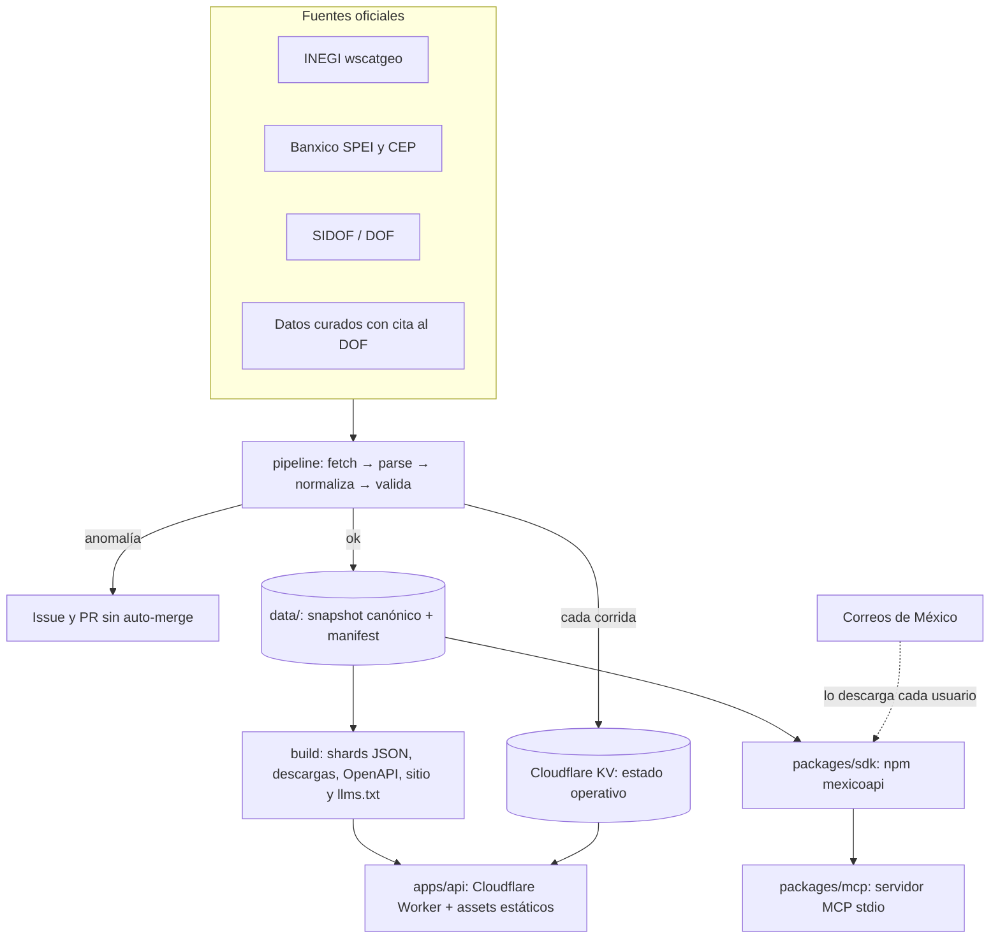

# MéxicoAPI · Diseño técnico v1

Fecha: 2026-10-17 · Estado: propuesta · Autor: Daniel Pereda

Arquitectura de la primera versión de MéxicoAPI: qué datos entran, cómo se obtienen y validan, cómo se publican y con qué garantías. Las decisiones abiertas están en la sección 14.

## 1. Intención

MéxicoAPI publica los datos de referencia de México que todo sistema necesita. Sus cualidades son:

- **Correctos:** cada dato tiene su fuente oficial, su fecha y su hash.
- **Al día:** se actualizan solos, en menos de 24 h después de que la fuente publica.
- **Rápidos:** se sirven como archivos estáticos desde el borde de Cloudflare.
- **Seguros:** solo lectura, sin datos personales, con cadena de suministro verificable.
- **Baratos de mantener:** $0–5 USD al mes y pocas horas por semana.

### Cualidades medibles

| Cualidad | Objetivo v1 | Cómo se mide |
| --- | --- | --- |
| Frescura | Dato automático actualizado ≤ 24 h después de publicarse en la fuente | `meta.as_of` contra la fecha de la fuente; job diario de frescura |
| Exactitud | 0 diferencias contra la fuente en las pruebas de muestreo | Pruebas que comparan registros al azar contra la fuente oficial |
| Procedencia | 100 % de los datasets con fuente, URL, licencia, fecha y sha256 | Validación en CI de cada `manifest.json` |
| Latencia de la API | p95 < 100 ms desde México para endpoints estáticos | Prueba de humo tras cada despliegue más analítica de Cloudflare |
| Disponibilidad | "Mejor esfuerzo", con descarga completa y paquete offline como respaldo | Status page y monitoreo externo gratuito |
| Calidad de código | Núcleo con cobertura ≥ 95 %, pipeline ≥ 85 % | Umbrales de Vitest en CI |
| Costo | ≤ $5 USD al mes | Facturación de Cloudflare |

## 2. Alcance

### v1 (este diseño)

| Dataset | Fuente | Tipo | Licencia | Se redistribuye |
| --- | --- | --- | --- | --- |
| Estados y municipios (CVEGEO) | INEGI wscatgeo v2 (JSON, sin token) | Automático | INEGI: libre, incluso comercial, con crédito | Sí |
| Bancos y participantes SPEI | JSON del portal CEP de Banxico (códigos), cruzado con el PDF oficial de participantes (nombres y participación) | Automático; altas y bajas con revisión humana | Banxico: autorización general con cita | Sí |
| Tipo de cambio FIX y UDIS, desde 2020-01-01 | SIDOF del DOF (JSON sin token): tipos 158 y 159 | Automático diario | Publicación oficial del DOF | Sí |
| Días inhábiles: Ley Federal del Trabajo (cualquier año, por reglas), bancos/CNBV (2025–2026) y SAT (2026) | DOF, LFT art. 74, disposiciones de la CNBV, CFF art. 12 y regla 2.1.6 de la RMF | Curado, con cita al DOF | Textos oficiales | Sí |
| UMA (2017–2026), salario mínimo (2019–2026) y tarifas de ISR (mensual 2026, anuales 2025 y 2026) | INEGI, resolución de la CONASAMI y Anexo 8 de la RMF, tal como se publican en el DOF | Curado, con cita al DOF | UMA: términos de libre uso del INEGI. Salario mínimo y tarifas: texto oficial del DOF, que no es objeto de derecho de autor (LFDA art. 14, fracción VIII) | Sí |
| Validadores: CLABE (con banco y plaza), RFC, CURP y NSS (formato y dígito verificador) | Algoritmos públicos (sección 8.1) | Código propio, sin dependencias | MIT | Sí |
| Códigos postales y colonias (SEPOMEX) | Correos de México | **Lo descarga cada usuario** (sección 7) | "Uso particular… ni su distribución a terceros" | **No** |

### v1.1 y después

- Catálogos CFDI 4.0 (reusando phpcfdi).
- Poder Judicial federal y calendario del IMSS.
- TIIE e INPC.
- Lista 69-B.
- Cuotas del IMSS y subsidio al empleo.
- Paquete PyPI y MCP remoto.

### Fuera de alcance

- Verificación de personas (RENAPO, INE).
- Resolver CAPTCHAs o burlar protecciones anti-bots.
- Consultas en vivo por usuario contra fuentes del gobierno.
- Cualquier dato personal.

## 3. Hallazgos que cambiaron el diseño (verificados el 2026-10-17)

| Hallazgo | Evidencia | Decisión |
| --- | --- | --- |
| El catálogo de SEPOMEX prohíbe distribuirlo a terceros | La primera línea del `CPdescarga.txt` descargado: "se proporciona en forma gratuita para uso particular, no estando permitida su comercialización, total o parcial, ni su distribución a terceros bajo ningún concepto" | No se publica en la API ni en los paquetes. El SDK lo descarga en la máquina del usuario (sección 7). Se pide permiso a SEPOMEX y a la ATDT (sección 14) |
| La versión CC-BY de SEPOMEX en datos.gob.mx son polígonos, no colonias, y bloquea clientes no-navegador | `package_show` de `codigos_postales_entidad_federativa_2026`: 32 shapefiles; la descarga devuelve HTTP 403 "Access Denied" desde curl | Fuera de v1. No se burla el bloqueo |
| La descarga de SEPOMEX funciona con el formulario público | POST con `__VIEWSTATE`, `rblTipo=txt`, `cboEdo=00`: ZIP de 2.1 MB → TXT de 15.7 MB en ISO-8859-1, 159,368 filas, 31,867 CP, 2,478 municipios | El comando del SDK replica ese formulario |
| INEGI responde JSON sin token | `gaia.inegi.org.mx/wscatgeo/v2/mgee/` y `/mgem/25` | Fuente automática de estados y municipios |
| Los códigos de municipio de SEPOMEX coinciden con INEGI | CP 80000: `c_estado=25`, `c_mnpio=006` = INEGI 25006 (Culiacán); 2,478 municipios en ambos | El SDK une CP con CVEGEO |
| SIDOF da tipo de cambio sin token | `sidof.segob.gob.mx/dof/sidof/indicadores/158/13-10-2026/17-10-2026` | Fuente del FIX y de las UDIS sin token de Banxico |
| El portal CEP de Banxico lista instituciones en JSON | `banxico.org.mx/cep/instituciones.do?fecha=…` con códigos de 5 dígitos (40012 BBVA; los 3 finales son el código de banco de la CLABE) | Es la fuente de los códigos y de la membresía activa; el PDF oficial aporta la razón social, el sector y la participación directa. Una diferencia de membresía entre ambos abre un issue |

## 4. Arquitectura



Principios:

1. **El snapshot es la fuente de verdad.** Todo lo publicado (API, descargas, paquetes, docs) se deriva de `data/`, versionado en git. El historial de git es el historial de cambios.
2. **Sin base de datos.** No hay base de datos ni cron en Cloudflare. El Worker corre primero en `/v1` y `/v1/*`, valida cada parámetro, sirve los shards estáticos con `ASSETS.fetch`, calcula funciones puras y pone encabezados. Las descargas (`/descargas/*`) y las páginas del sitio son assets directos y no pasan por el Worker; fuera de `/v1`, lo que no es un asset lo responden los assets con `404.html`. Lo único que guarda Cloudflare (en KV) es el estado operativo de las corridas, nunca los datos.
3. **Separar lo automático de lo curado.** Los datos automáticos los produce el pipeline. Los curados (días inhábiles, constantes) los escribe una persona en YAML, con cita obligatoria al DOF, y entran por PR revisado.
4. **Falla a lo último bueno.** Si una fuente falla, se sirve el último snapshot válido marcado como desactualizado.
5. **Núcleo puro.** Las reglas (CLABE, días hábiles, validación de formatos) viven en funciones puras sin I/O, probadas con TDD y compartidas por API, SDK y MCP. La aritmética de fechas del núcleo es de enteros (días desde una época, sin `Date`), así que sumar 3650 días hábiles cabe en el límite de CPU de un Worker.

## 5. Estructura del repositorio

Monorepo con pnpm workspaces, TypeScript estricto y ESM.

```
mexicoapi/
├─ packages/
│  ├─ core/        # @mexicoapi/core (interno): esquemas Zod, tipos, funciones puras
│  ├─ pipeline/    # privado: fuentes, parsers, normalizadores, validadores, snapshot, build
│  ├─ sdk/         # npm "mexicoapi": cliente HTTP + datos offline + CLI (sepomex sync)
│  └─ mcp/         # npm "mexicoapi-mcp": servidor MCP stdio de solo lectura
├─ apps/
│  └─ api/         # Cloudflare Worker (wrangler) + assets estáticos generados (API, descargas y sitio)
├─ data/
│  ├─ inegi-estados/    # estados.json, manifest.json, raw/
│  ├─ inegi-municipios/ # municipios.json, manifest.json, raw/
│  ├─ bancos/           # bancos.json, manifest.json, raw/
│  ├─ tipo-cambio-fix/  # fix.json (toda la serie), manifest.json, raw/ (un crudo por año)
│  ├─ udis/             # udis.json (toda la serie), manifest.json, raw/ (un crudo por año)
│  ├─ curado/           # YAML que transcribe una persona, con cita al DOF (sección 8)
│  ├─ dias-inhabiles-cnbv/, dias-inhabiles-sat/   # JSON canónico generado por `curar`
│  └─ constantes-uma/, constantes-salario-minimo/, isr-tarifas/   # ídem
├─ scripts/verify.sh
├─ .github/workflows/  # ci, datos, despliegue, publicación, seguridad, frescura
├─ README.md  LICENSE  DATA_LICENSE.md  SECURITY.md  CONTRIBUTING.md
└─ docs/   # referencia de la API, docs por dataset, diseño y operación
```

`@mexicoapi/core` se empaqueta dentro del SDK y no se publica aparte en v1. Así hay dos paquetes públicos: `mexicoapi` y `mexicoapi-mcp`.

## 6. Modelo de datos

### Manifiesto por dataset (`data/<dataset>/manifest.json`)

```json
{
  "dataset": "inegi.municipios",
  "schema_version": 1,
  "as_of": "2026-10-17",
  "fetched_at": "2026-10-17T06:12:03Z",
  "data_file": "municipios.json",
  "data_sha256": "…",
  "records": 2478,
  "sources": [
    {
      "name": "INEGI, Catálogo Único de Claves de Áreas Geoestadísticas Estatales, Municipales y Localidades",
      "url": "https://gaia.inegi.org.mx/wscatgeo/v2/",
      "license": "Términos de libre uso de la información del INEGI",
      "license_url": "https://www.inegi.org.mx/inegi/terminos.html",
      "citation": "INEGI. Catálogo Único de Claves de Áreas Geoestadísticas…",
      "published_at": null,
      "raw": [
        { "file": "raw/mgem-01.json", "url": "https://gaia.inegi.org.mx/wscatgeo/v2/mgem/01", "sha256": "…" }
      ]
    }
  ]
}
```

El manifiesto describe **los datos** y solo cambia cuando cambian los datos. Así, el historial de git sigue siendo el historial de cambios de los datos.

El estado operativo lo escribe el job `estado-kv` de `datos.yml`, aparte del job que actualiza los datos y solo desde `main`. Mientras no haya registro de corridas (por ejemplo, sin los secretos de Cloudflare), `status` es `unknown`.

El **estado operativo** (última corrida, último éxito, `ok` o `stale`) vive en Cloudflare KV, en una clave por dataset (`estado:<dataset>`). Cada workflow lo escribe al terminar, haya cambios o no y falle o no. `/v1/status` combina ambos: `as_of`, `records`, `data_sha256` y, en las series, `cobertura` (`desde` y `hasta`) del build, y `last_attempt`, `last_success` y `status` (`ok`, `stale` o `unknown`) de KV. `last_success` avanza con `sin_cambios` y con `actualizado` cuando la corrida publicó el cambio (código 0); no avanza con `requiere_revision`, con una corrida que pide revisión (código 3) ni con una fallida.

La frescura no va en `meta` de las respuestas de datos, solo en `/v1/status`. Así los shards son estáticos y su `ETag` no cambia con la hora.

Así una corrida sin cambios no genera commit, PR ni despliegue, y la frescura sigue siendo visible. KV gratis permite 100 mil lecturas y mil escrituras al día; se usan de 1 a 3 escrituras diarias.

**Originales crudos:** el último original de cada fuente se guarda en `data/<dataset>/raw/` (todos los de v1 pesan menos de 1 MB) y su sha256 va en el manifiesto. El historial de git conserva las versiones anteriores, así que cualquiera puede comprobar el hash y reconstruir un dato.

### Registros v1

| Dataset | Campos | Clave |
| --- | --- | --- |
| `inegi.estados` | `cve_ent` (2), `nombre`, `abreviatura`, `cvegeo` | `cve_ent` |
| `inegi.municipios` | `cvegeo` (5), `cve_ent`, `cve_mun` (3), `nombre`, `cve_cabecera` (`null` en las 16 alcaldías de la CDMX, cuya fuente envía "----") | `cvegeo` |
| `bancos` | `codigo` (3, el de la CLABE), `codigo_spei` (4 o 5 dígitos, como lo publica el CEP; BANXICO es `2001`), `nombre_corto` (CEP), `razon_social` (PDF oficial; `null` si no aparece; un inactivo conserva la última conocida, o `null` si nunca apareció en el PDF), `sector` (PDF, con la misma regla), `tipo` (por prefijo del código SPEI: `40` banca múltiple, `37` banca de desarrollo, `90` otras entidades; Banxico aparte), `participacion` (`directa` si está activo y aparece en el PDF; `no_confirmada` si solo aparece en el CEP o si está inactivo, porque ya no participa), `activo`, `baja_detectada` (fecha de muestreo, si dejó de aparecer), `historial` (periodos observados `{codigo_spei, nombre_corto, desde, hasta}` como intervalos `[desde, hasta)`; `hasta: null` es el vigente) | `codigo` |
| `plazas-clabe` | `codigo` (3), `plaza`, `estado` | `codigo` |
| `tipo-cambio.fix` | `fecha_publicacion`, `valor` (texto con 4 decimales) | `fecha_publicacion` |
| `udis` | `fecha`, `valor` (texto con 6 decimales) | `fecha` |
| `dias-inhabiles.cnbv`, `dias-inhabiles.sat` | `fecha`, `autoridad` (`cnbv` o `sat`), `motivo`, `tipo` (`descanso` o `vacaciones`; la CNBV solo tiene `descanso`), `fuente` (`nombre`, `url`, `fecha_publicacion`, `fragmento`). Los días de la LFT no son un dataset: salen de una función del núcleo | `fecha` en cada dataset |
| `constantes.uma` | `anio`, `diaria`, `mensual`, `anual`, `vigencia_desde`, `fuente` | `anio` |
| `constantes.salario-minimo` | `anio`, `zona` (`general`, `zlfn`), `diario`, `vigencia_desde`, `fuente` | `anio + zona` |
| `isr.tarifas` | `anio`, `periodo` (`mensual`, `anual`), `tramos`: `limite_inferior`, `limite_superior`, `cuota_fija`, `tasa_excedente`; `fuente` | `anio + periodo` |

Reglas de normalización:

- UTF-8 en forma NFC.
- Nombres oficiales tal como los publica la fuente, sin "arreglarlos".
- Claves como strings, con ceros a la izquierda.
- Montos como strings decimales, nunca `float`, para no perder precisión.
- Orden estable por clave, para que los diffs de git sean legibles.

## 7. Códigos postales: el usuario lo descarga

Como SEPOMEX prohíbe la redistribución, MéxicoAPI publica **la herramienta, no los datos**. La entrada `mexicoapi/sepomex` (solo Node) hace en la máquina del usuario lo mismo que una persona en la página:

1. Antes de pedir nada muestra el aviso de uso de Correos de México y una nota que deja claro que los datos no vienen de MéxicoAPI (por omisión en stderr; la opción `aviso` lo recibe).
2. `GET` de `CodigoPostal_Exportar.aspx`: toma los campos ocultos del formulario ASP.NET (`__VIEWSTATE`, `__VIEWSTATEGENERATOR`, `__EVENTVALIDATION` y cualquier otro que traiga) y su `action` (del mismo origen), y revisa que estén `cboEdo` con la opción `00`, `rblTipo` con `txt` y el botón `btnDescarga`. Ningún valor del formulario va fijo en el código.
3. `POST` con esos campos, `cboEdo=00`, `rblTipo=txt` y las coordenadas del botón de imagen. Las peticiones dicen quién descarga (`User-Agent: mexicoapi (+https://github.com/Dagel4k/mexicoapi)`), no siguen redirecciones y piden las direcciones IPv4 primero: el sitio corta el TLS por IPv6 (verificado el 2026-10-18). El cuerpo se lee por partes y se corta al pasar del límite; la descarga se rinde tras 60 s sin recibir nada o 5 minutos en total. Un 401, 403 o 429, o una página con CAPTCHA, es un error `bloqueado` que no se intenta evadir: el mensaje dice cómo bajar el archivo a mano y cargarlo con `sepomex.importar(ruta)`.
4. Lee el ZIP con un lector propio de un solo archivo sobre `node:zlib`. Es error un ZIP con más de un archivo, un nombre con carpetas o `..`, cifrado, ZIP64, otro método que no sea deflate, o un tamaño o CRC-32 que no coincide. Límites: página 1 MB, ZIP 20 MB, TXT 60 MB (el oficial pesa 2.1 MB y 15.7 MB).
5. Decodifica ISO-8859-1 (o UTF-8 si el archivo ya lo es), exige el aviso en la primera línea y las 15 columnas oficiales por nombre, revisa cada fila (número de campos, CP de 5 dígitos, claves de entidad y municipio, nombres) y que vengan las 32 entidades.
6. Une cada CP con el CVEGEO de INEGI (`c_estado` + `c_mnpio`) usando los municipios del paquete. Un municipio que no está en INEGI es una advertencia contada (el CP queda con `cvegeo: null` y el nombre de SEPOMEX), no un error.
7. Guarda en la caché del usuario (`%LOCALAPPDATA%\mexicoapi\sepomex` en Windows; `$XDG_CACHE_HOME/mexicoapi/sepomex` o `~/.cache/mexicoapi/sepomex` en los demás; la opción `dir` la cambia) `codigos-<id>.json`, `codigos-<id>.sqlite` si `node:sqlite` carga (las 15 columnas oficiales en UTF-8 más `cvegeo`) y al final `meta.json` (fecha, filas, CP, municipios, advertencias, aviso y SHA-256 del TXT), cada uno con un temporal que se renombra. Si algo falla antes de `meta.json` se borra lo nuevo y la caché anterior queda igual. Mientras trabaja, `sync` (o `importar`) tiene el candado `sync.lock` del directorio: otra en el mismo directorio falla de inmediato con `ocupado`, sin pedir nada al sitio; un candado de más de 10 minutos o de un proceso de este equipo que ya terminó se toma. Al final se borran los archivos del catálogo reemplazado y los restos de más de una hora. Con Node anterior a 22.13 (sin `node:sqlite`) la caché queda solo en JSON y `resumen().sin_sqlite` dice por qué.
8. Memoria: guardar el catálogo completo (unas 160 mil filas) usa por un momento unos 340 MB; la primera consulta lee el JSON (unos 17 MB) y lo deja en memoria del proceso.

En código: `import { sepomex } from "mexicoapi/sepomex"` → `await sepomex.sync()`, `await sepomex.cp("80000")`, `await sepomex.colonias("80000")`, `await sepomex.resumen()` y `await sepomex.importar(ruta)`. Los fallos son `SepomexError` con `tipo`: `bloqueado`, `sin-respuesta`, `pagina-inesperada`, `archivo-invalido`, `sin-datos`, `cache-invalida`, `ocupado` o `escritura` (disco lleno, sin permiso o SQLite que falla).

El MCP local usa esa misma caché. Cada usuario hace su propio "uso particular" de la fuente.

Si SEPOMEX o la ATDT dan permiso o publican el catálogo tabular abierto, se activa un dataset `sepomex.cp` en la API, sin cambiar el contrato del SDK.

## 8. Pipeline

### Etapas

`fetch → parse → normalize → validate → diff → write`

Cada fuente implementa una interfaz común, `Source<TRaw, TRecord>`:

- `fetch()` devuelve bytes y metadatos HTTP. El timeout es de 30 s, con 3 reintentos y backoff exponencial. Usa un User-Agent propio, `mexicoapi-bot/1 (+https://github.com/Dagel4k/mexicoapi)`. Respeta `robots.txt` y hace como máximo 1 petición por segundo por host.
- `parse()` interpreta CSV, JSON, PDF o HTML con parsers probados contra fixtures reales guardados en `packages/pipeline/test/fixtures/`.
- `normalize()` convierte al esquema de `@mexicoapi/core`.
- `validate()` revisa el esquema con Zod y luego los invariantes del dataset. Ejemplos: 32 estados, ≥ 2,400 municipios, códigos de banco únicos.
- `diff()` compara contra el snapshot anterior y calcula altas, bajas y cambios.

FIX y UDIS se guardan como un dataset por serie: toda la historia en un archivo de datos (la serie completa pesa menos de 300 KB) y la respuesta original de la fuente, un archivo por año, en `raw/`. No hay `fuente_dof` por registro: el SIDOF no da la nota del DOF de cada valor, así que la cita va en el manifiesto y quien necesite la nota exacta la busca por fecha en el DOF. Para el Worker, el build parte cada serie en archivos anuales (`v1/_internos/fix/AAAA.json` y `udis/AAAA.json`); cada uno trae el `tramo` que cubre (`desde`, `hasta`) y sus registros, y el meta interno trae la cobertura de la serie. El tramo distingue un día sin publicación de un dato que todavía no se carga.

### Umbrales de anomalía

Si un dataset cambia más que su umbral, el PR se abre **sin auto-merge**, con la etiqueta `revisar` y un issue. Por ejemplo:

- municipios: más de 0.5 % de altas o bajas;
- bancos: más de 3 cambios;
- FIX: valor fuera de ±5 % del día anterior, o una publicación en sábado, en domingo o en un día de descanso de la CNBV dentro de su calendario (la regla de certeza de la consulta supone que no las hay; el bot lee el calendario del YAML curado);
- FIX y UDIS: un alta con fecha anterior a la última ya publicada, porque rellena la serie y la API pudo haber respondido antes otra cosa para ese día.

Es la defensa contra fuentes rotas o manipuladas.

### Datos curados

Cinco datasets se transcriben a mano del DOF: `dias-inhabiles.cnbv`, `dias-inhabiles.sat`, `constantes.uma`, `constantes.salario-minimo` e `isr.tarifas`. Cada uno tiene un YAML en `data/curado/` y una carpeta generada en `data/` con su JSON canónico y su manifiesto. Los días de la LFT no se transcriben: salen de una función del núcleo.

El YAML declara en `fuentes` cada publicación una sola vez (`nombre`, `url`, `fecha_publicacion`, `fragmento` literal, `licencia` y `licencia_url`) y cada registro apunta a una por su clave. El comando `curar` (sin red) valida el YAML y genera `data/<dataset>/`; en un calendario escribe además `calendario.json`, con sus tipos de plazo, la cobertura de cada uno y la fuente de los fines de semana de cada año. El JSON nunca se edita a mano. `verificar` regenera esos archivos desde el YAML, `calendario.json` incluido, y falla si no coinciden byte a byte. El procedimiento está en [docs/operacion/datos-curados.md](../operacion/datos-curados.md).

CI exige en cada fuente:

- `url` del DOF, del SIDOF o de la ley vigente en diputados.gob.mx; en una nota del DOF, la fecha de la URL coincide con `fecha_publicacion`;
- `fecha_publicacion`;
- `fragmento`, el texto citado.

Además, cada dataset pasa invariantes que atrapan errores de captura, con montos en centavos enteros:

- UMA: mensual igual a la diaria por 30.4, anual igual a la mensual por 12, vigencia el 1 de febrero, y el fragmento contiene los montos;
- salario mínimo: vigencia el 1 de enero, el fragmento contiene el monto y la zona de la Frontera Norte es mayor que la general;
- ISR: los tramos encadenan, las tasas crecen y son las mismas en todas las tarifas, y cada cuota fija es la anterior más el impuesto completo del tramo anterior, con una tolerancia de un centavo. Lo que pase de eso se declara en `excepciones_cuota_fija` con el valor publicado y el recalculado, y falla si no hace falta;
- días inhábiles: cada día cae dentro de la cobertura de su tipo y en la de algún `tipo_plazo` (el Worker rechaza el calendario entero si un día queda fuera), los días de regla ("tercer lunes de noviembre") se recalculan a partir del `motivo`, y un `motivo` que empieza con día y mes ("16 de septiembre") debe coincidir con la fecha.

Las reglas de un calendario armado viven en el núcleo (`crearCalendarioCurado`): los tipos de plazo y sus `excluir_tipos` son los de `PLAZOS` de su autoridad, `general` cuenta todos los tipos de día, un plazo contiene la cobertura de los demás, cada año de esa cobertura cita sus fines de semana y los días van en orden y dentro de ella. Las usan el Worker al cargar el shard, el paquete al armar sus calendarios, y `curar` y `verificar` antes de escribir o comparar: un YAML que el Worker rechazaría falla en `curar` con el mismo mensaje.

**Cobertura.** Los calendarios declaran en el YAML el rango en que su lista está completa, por tipo de día. El build la lleva a la API junto con la cobertura de cada `tipo_plazo`, que es la intersección de las coberturas de los tipos de día que ese plazo cuenta. Hoy el SAT tiene `descanso` hasta el 2026-12-31 y `vacaciones` hasta el 2026-11-30, porque el segundo periodo de vacaciones de 2026 no se ha publicado: `declaraciones_pagos`, que no cuenta las vacaciones, llega al 2026-12-31 y `general` al 2026-11-30. La CNBV cubre 2025 y 2026. Como la lista de días por sí sola no dice hasta dónde está completa, las descargas traen la cobertura de cada `tipo_plazo` aparte (`dias-inhabiles-coberturas.json` y `.csv`, y la tabla `coberturas_calendario` del SQLite).

Las reglas fijas de la LFT (por ejemplo, el primer lunes de febrero) se calculan con una función del núcleo y se prueban año por año.

### Ejecución

GitHub Actions por dataset con `schedule`:

- INEGI: semanal.
- Bancos: diario.
- FIX y UDIS: diario, después de su publicación; el FIX a las 13:30 y las UDIS a las 14:30 hora de Ciudad de México, en grupos separados para que una falla de una serie no detenga la otra; la hora de diferencia evita que los dos PRs compitan por estar al día con `main`.

Si hay cambios, el bot abre un PR `datos(<dataset>): AAAA-MM-DD` con el resumen del diff. Se auto-fusiona si pasa CI y está dentro de los umbrales.

El bot actúa con una **GitHub App propia** (tokens que duran una hora y permisos solo sobre este repo: contenidos, pull requests e issues), no con `GITHUB_TOKEN`. Los PRs abiertos con `GITHUB_TOKEN` no disparan CI ni despliegue, y un token personal de larga duración es justo lo que la sección 12 evita.

Al terminar cada corrida, el job `estado-kv` escribe el estado operativo en KV, y `frescura.yml` abre un issue cuando un dataset se desactualiza ([docs/operacion/cloudflare.md](../operacion/cloudflare.md)).

**Bancos:** las altas y las bajas de instituciones siempre van a revisión humana. Los cambios de nombre se fusionan solos.

Una institución que deja de aparecer no se borra: queda con `activo: false` y su `baja_detectada`, para que las CLABE antiguas se sigan decodificando. Si el JSON del CEP y el PDF oficial no coinciden en membresía, se abre un issue. Los nombres del CEP y del PDF coinciden, así que no hay mapeo curado: si un nombre no cruza, se abre un issue.

## 8.1 Reglas de cálculo (contratos del núcleo)

Estas reglas son la parte con más riesgo legal. Cada una lleva su fundamento en el código, en la respuesta de la API y en la documentación.

### Días hábiles

Tres reglas aplican a todas las autoridades:

- **Cuándo empieza el conteo:** el plazo empieza a contar **el día hábil siguiente** a `desde`, sea `desde` hábil o no. Es el criterio general de cómputo de plazos.
- **Fines de semana:** sábado y domingo son inhábiles en las tres autoridades de v1. Cada fin de semana se cita con la publicación de su año: en la CNBV, las disposiciones de ese año.
- **El resultado:** siempre es un día hábil.

| Autoridad | Inhábiles | Fundamento |
| --- | --- | --- |
| `lft` | Sábados, domingos y días de descanso obligatorio del art. 74, calculados por regla para cualquier año (incluye el 1 de octubre cada seis años, a partir de 2024) | LFT art. 74 |
| `cnbv` (bancos) | Sábados, domingos y los días del calendario anual que la CNBV publica en el DOF | Disposiciones de la CNBV publicadas en el DOF de cada año |
| `sat` | Sábados, domingos, días del art. 12 del CFF y periodos de vacaciones de la regla 2.1.6 de la RMF | CFF art. 12; RMF regla 2.1.6 |

**SAT y tipo de plazo.** El art. 12 del CFF excluye las vacaciones generales de las autoridades fiscales en los plazos de **declaraciones y pagos**. Por eso, con `autoridad=sat` el endpoint exige `tipo_plazo`:

- `general`: sí cuenta las vacaciones como inhábiles.
- `declaraciones_pagos`: no las cuenta como inhábiles.

**Calendario incompleto.** Si el cálculo cruza fechas que el calendario no cubre, la API responde **422** problem+json de tipo `calendario-incompleto`, con la autoridad, la primera fecha sin cobertura y la cobertura. Cuando el SAT `general` no llega pero `declaraciones_pagos` sí, el `detail` lo dice. Hoy la CNBV cubre 2025 y 2026, el SAT 2026, y el SAT `general` solo hasta el 2026-11-30 mientras falte su segundo periodo de vacaciones.

Solo con `permitir_incompleto=true` calcula con lo conocido, y entonces responde con `advertencias[]`. Un plazo legal equivocado sin aviso es peor que un error. Si un plazo es más corto que la cobertura más amplia del calendario (el SAT `general`), calcula con un calendario de respaldo: el mismo plazo sobre la cobertura amplia y todos los días publicados en ella. Así, fuera de la cobertura del plazo siguen descontándose el 25 de diciembre y los demás días ya conocidos, y no solo los fines de semana. Si el cálculo pasa por esa zona, lo advierte nombrando los tipos de día que pueden faltar. Pasada la cobertura más amplia solo se descuentan fines de semana, y la advertencia del núcleo nombra la autoridad en mayúsculas (`Calendario incompleto: SAT 2027; …`).

### Tipo de cambio FIX

Hay dos modos, y la operación cita su regla:

| Modo | Llamada | Qué responde |
| --- | --- | --- |
| Publicación | `GET /v1/tipo-cambio/fix?publicado=AAAA-MM-DD` | El valor publicado en el DOF ese día, o 404 si ese día no hubo publicación |
| Operación (lo que pide el SAT) | `GET /v1/tipo-cambio/fix?operacion=AAAA-MM-DD` | El último FIX publicado en el DOF **antes** de esa fecha, la fecha de esa publicación y la cita del CFF art. 20 |
| Último | `GET /v1/tipo-cambio/fix/ultimo` | La publicación más reciente cargada |

Para elegir la publicación no se necesita el calendario bancario: basta la última publicación anterior. El calendario de la CNBV solo sirve para saber si ya se puede responder (ver la certeza más abajo). Las UDIS tienen un solo modo, `GET /v1/udis?fecha=AAAA-MM-DD`, con un valor por cada día del calendario.

Las reglas de consulta viven en el núcleo, para que el SDK y el MCP den la misma respuesta que la API.

**Certeza de la operación.** `operacion` solo responde cuando la respuesta es cierta: cuando están cargados todos los días hasta la víspera en que pudo haber publicación. Si falta alguno, el Worker no devuelve un valor anterior: responde `dato-no-disponible`. No cuentan los sábados y domingos, porque el DOF no publica el FIX, ni los días de descanso de la CNBV dentro de la cobertura de su calendario: de 2020 a octubre de 2026 todos los días entre semana sin FIX son feriados bancarios, y ningún feriado bancario entre semana tiene FIX. Fuera de esa cobertura un feriado cuenta como día entre semana sin cargar. Así, la mañana después de un feriado ya hay respuesta: si el lunes 16 de noviembre de 2026 es feriado, el martes 17 por la mañana lo cargado termina en el viernes 13 y `operacion=2026-11-17` responde la publicación del viernes 13. El costo que queda es que un cliente que pregunta temprano por mañana recibe 404 hasta la siguiente corrida.

El núcleo recibe esos días como una opción de `fixParaOperacion` y `fixPublicado` (`sinPublicacion`); sin ella solo salta fines de semana, igual que antes. Un hueco de más de 31 días después del último dato da `dato-no-disponible` sin revisarlo. Solo cuentan los días de tipo `descanso`, y la verificación de los datos curados rechaza cualquier otro tipo en la CNBV. El Worker, y el paquete sin red, consultan primero solo con los fines de semana y cargan el calendario de la CNBV únicamente si la respuesta sería `dato-no-disponible`: los feriados solo pueden volver cierta una respuesta que sin ellos no lo es. Si el calendario no carga, se queda con la respuesta de los fines de semana y registra un aviso, en vez de responder 500; la falla no se recuerda. El supuesto lo vigila el bot de datos: un FIX publicado en un día de descanso de la CNBV pide revisión.

**Dos 404.** `no-encontrado` es definitivo: ese día no hubo publicación o la fecha es anterior al inicio de la serie. Con `publicado`, un fin de semana o día de descanso de la CNBV posterior al último dato también es `no-encontrado` si de por medio solo hay días así: el DOF no publica el FIX esos días. `dato-no-disponible` puede cambiar: la fecha es posterior a lo cargado y falta algún día en que pudo haber publicación, o falta la víspera. Ambos traen `fecha` y `cobertura`; un cliente que solo mira el estado HTTP no los distingue, el `type` sí.

### Validadores

Se escriben en el núcleo, sin dependencias. Cada uno se prueba contra vectores de prueba tomados de librerías existentes, a las que se da crédito (`clabe-validator` MIT, `python-stdnum` LGPL: solo como referencia de vectores, sin copiar código).

Cada validador responde por separado:

- `formato_valido`;
- `digito_verificador_valido`, cuando aplica;
- la nota fija "no confirma que exista ante el SAT, RENAPO o el IMSS".

| Validador | Qué revisa |
| --- | --- |
| CLABE | 18 dígitos, dígito de control (pesos 3, 7, 1, módulo 10), banco (dataset `bancos`) y plaza (dataset `plazas-clabe`) |
| RFC | Estructura de persona física (13) y moral (12), fecha válida y dígito verificador de la homoclave |
| CURP | Estructura, fecha, sexo, entidad y dígito verificador (algoritmo reconstruido y documentado públicamente) |
| NSS | 11 dígitos y dígito verificador (Luhn) |

El catálogo de plazas de la CLABE no tiene fuente oficial pública. Entra como dataset curado de **referencia**, con crédito a `clabe-validator`, y lo marca `meta.referencial: true`.

## 9. API pública (Cloudflare Worker)

### Diseño

- **Base:** `https://<dominio>/v1/`. Sin dominio propio, se usa `mexicoapi.<cuenta>.workers.dev`.
- **Protocolo:** REST de solo lectura, JSON en UTF-8, versión en la ruta (`/v1`). Los cambios incompatibles van a `/v2`.
- **Respuesta:** `{ "data": …, "meta": { dataset, as_of, sources: [{ name, url, license, license_url, citation }], docs } }`. `sources` es una lista porque un dataset puede tener varias fuentes (bancos tiene dos). `meta` no lleva el estado de frescura: eso vive en `/v1/status`, que responde `{ "data": [...] }` sin `meta`. `/` es la página de inicio del sitio y `/v1` responde un índice en JSON.
- **Errores:** `application/problem+json` (RFC 9457), con `type`, `title`, `status`, `detail` e `instance`. Nunca incluyen trazas. El `type` es la URI absoluta de la sección correspondiente de `docs/api/problemas.md` en GitHub (`https://github.com/Dagel4k/mexicoapi/blob/main/docs/api/problemas.md#<tipo>`), estable sin dominio propio; si llega un dominio, los `type` se quedan como identificadores.
- **Caché:**
  - Datos que cambian: `Cache-Control: public, max-age=3600, stale-while-revalidate=86400, stale-if-error=604800`. No lleva `s-maxage=86400`: un caché compartido de 24 h rompería la meta de frescura de 24 h.
  - `/v1/tipo-cambio/fix/ultimo`: `public, max-age=300`, sin `stale-while-revalidate` ni `stale-if-error`, porque cambia con cada publicación.
  - `/v1/status`: `public, max-age=60`. Errores: `no-store`.
  - Históricos (cuando existan): `public, max-age=31536000, immutable`.
  - `ETag` = hash del contenido en los shards; con `If-None-Match` responde 304.
- **Encabezados:** `Access-Control-Allow-Origin: *` (expone `ETag` y `Retry-After`), `X-Content-Type-Options: nosniff`, `Content-Security-Policy: default-src 'none'; frame-ancestors 'none'`. Sin cookies. Solo `GET`, `HEAD` y `OPTIONS`.
- **Privacidad:** el Worker no registra ni guarda consultas (la observabilidad está desactivada). Una CLABE viaja en la ruta; quien no quiera enviarla puede validarla sin red con el SDK.

### Endpoints v1

| Método y ruta | Qué devuelve | Cómo se sirve |
| --- | --- | --- |
| `GET /v1/estados` | 32 estados | Estático |
| `GET /v1/estados/{cve_ent}` | Un estado | Estático |
| `GET /v1/estados/{cve_ent}/municipios` | Municipios del estado | Estático |
| `GET /v1/municipios` · `GET /v1/municipios/{cvegeo}` | Todos los municipios (unos 300 KB, también en las descargas) o uno | Estático |
| `GET /v1/bancos` · `GET /v1/bancos/{codigo}` | Bancos y participantes SPEI | Estático |
| `GET /v1/clabe/{clabe}` | `valido`, `formato_valido`, `digito_verificador_valido`, `errores[]` y `detalle` (`banco`, `plaza`, `cuenta`, `digito_control`). La CLABE de un banco inactivo tiene formato válido y lleva `banco.activo: false` | Worker (función pura) |
| `GET /v1/tipo-cambio/fix?publicado=AAAA-MM-DD` · `?operacion=AAAA-MM-DD` · `/v1/tipo-cambio/fix/ultimo` | FIX por fecha de publicación o para una operación (sección 8.1) | Worker sobre archivos anuales estáticos |
| `GET /v1/udis?fecha=AAAA-MM-DD` | Valor de la UDI | Worker sobre archivos anuales estáticos |
| `GET /v1/dias-inhabiles?autoridad=lft\|cnbv\|sat&anio=2026` | `{ data, advertencias, meta }`: lista con citas. `advertencias` (de primer nivel, distinta de `data.advertencias` de `dias-habiles`) avisa cuando la lista solo está completa para algunos tipos de plazo, como el SAT 2026. 422 si el año no está en la cobertura | LFT: Worker (función pura). CNBV y SAT: Worker sobre un archivo estático del calendario |
| `GET /v1/dias-habiles?autoridad=lft\|cnbv\|sat&desde=AAAA-MM-DD&dias=15` (con `sat`, `&tipo_plazo=general\|declaraciones_pagos`, obligatorio) | Fecha resultante, días inhábiles saltados con su cita, `advertencias[]`; 422 si el calendario está incompleto (sección 8.1) | Worker (núcleo puro; los calendarios curados vienen de un archivo estático) |
| `GET /v1/plazas-clabe` | Catálogo de referencia de plazas | Estático |
| `GET /v1/constantes/uma?fecha=AAAA-MM-DD` | La UMA vigente ese día (rige del 1 de febrero al 31 de enero siguiente) | Worker sobre la lista estática |
| `GET /v1/constantes/uma/{anio}` · `/v1/constantes/salario-minimo/{anio}` · `/v1/isr/tarifa/{periodo}/{anio}` | Valores con fuente. Un año anterior al primero cargado da 404 `no-encontrado`; uno posterior al último, 404 `dato-no-disponible` | Estático (un archivo por año) |
| `GET /v1/status` | Frescura y estado de cada dataset (build más KV) | Worker: lee KV con caché de 60 s |
| `GET /v1/openapi.json` | Especificación OpenAPI 3.1 | Estático |
| `GET /descargas/*` | JSON, CSV y `mexicoapi.sqlite` completos | Estático |
| `GET /` · `/estado/` · `/llms.txt` · `/llms-full.txt` | El sitio (ver abajo) | Estático, sin Worker |

Todas las rutas de la tabla están implementadas, salvo `plazas-clabe`, que espera su catálogo.

`dias-habiles` acepta `dias` de 1 a 3650. Con `permitir_incompleto=true` calcula fuera de la cobertura del calendario con `advertencias` (secciones 8 y 8.1); si no, responde 422 `calendario-incompleto`. La cobertura de la LFT es de 2007-01-01 a 2100-12-31.

### Sitio

El sitio son páginas estáticas que genera el mismo build (`packages/pipeline/src/sitio/paginas/`), sin framework ni dependencias, a partir de los manifiestos:

- `/`: página de inicio con cómo empezar (API, paquete y servidor MCP), la tabla de datasets con su `as_of`, fuente y licencia, y las descargas. Mientras los paquetes no estén en npm, la constante `PUBLICADO_EN_NPM` hace que la página y `llms.txt` solo lo avisen, sin comandos de instalación ni configuración que copiar.
- `/estado/`: la frescura de cada dataset automático; un módulo propio (`sitio.js`) consulta `/v1/status` desde el navegador.
- `/llms.txt` (formato de llmstxt.org) y `/llms-full.txt`: la ruta de cada dataset con su `as_of`, y la referencia de la API, la de errores y las docs de cada dataset en un solo archivo, con los enlaces relativos cambiados por su URL en GitHub.
- `404.html`: con `not_found_handling: "404-page"`, los assets la sirven en cualquier dirección fuera de `/v1` que no es un asset, sin invocar al Worker. Dentro de `/v1`, una ruta que no existe sigue siendo un 404 problem+json del Worker.

Cada ruta del sitio y cada descarga tiene su propia regla en `_headers` (CSP, `nosniff` y caché; `Referrer-Policy` en el sitio, CORS en las descargas), sin comodines: ningún 404 recibe reglas, tampoco bajo `/descargas/`, y lleva su CSP en `<meta>`. Todo texto que viene de los datos se escapa y solo una URL `https://` entra a un enlace.

### Validación de entradas

Cada parámetro se valida con una expresión regular estricta antes de tocar cualquier dato. Por ejemplo, `cvegeo` es `^\d{5}$` y `clabe` es `^\d{18}$`. Una entrada inválida devuelve un 400 problem+json.

Un parámetro de query desconocido, repetido o vacío, o un segmento vacío (`?&`), también da 400. Un cliente que agrega `?_=` para romper el caché recibe 400. Una ruta con `%` da 404, y dentro de `/v1` una ruta con `/` final redirige con 308 a la ruta sin él.

### Despliegue

Dos Workers en la misma cuenta: `mexicoapi-staging` y `mexicoapi` (producción), ambos en `workers.dev`. Staging es un Worker aparte y no una URL de vista previa, porque las vistas previas con assets y rate limiting no están garantizadas.

`apps/api/scripts/cloudflare.ts configurar` resuelve (o crea) el namespace de KV titulado `mexicoapi-estado` y genera la configuración de cada entorno a partir de `wrangler.jsonc`, con el binding `ESTADO` de KV y el de rate limiting. La base se llama `mexicoapi-local`: un `wrangler deploy` a mano con ella no publica producción sin esos bindings. El namespace se comparte entre staging y producción, porque el estado es del pipeline de datos y no del entorno.

`despliegue.yml` corre en cada merge a `main` y a mano, solo desde `main` y en el Environment `produccion`: despliega a staging, corre la prueba de humo (`apps/api/scripts/humo.ts`, hasta 5 intentos con esperas de 10, 20, 30 y 60 s), despliega a producción y vuelve a correr el humo si la versión llegó a subirse, aunque el paso de despliegue fallara después. Si el humo de producción falla, ejecuta `wrangler rollback --yes` y la corrida queda en rojo; en el primer despliegue no hay versión anterior y el resumen dice que no se pudo revertir. El resumen lista las URLs, los IDs de versión y el resultado de la reversión. Sin los secretos de Cloudflare no despliega y deja un aviso.

Rate limiting: el binding de Workers limita a 600 peticiones por minuto por IP (las IPv6 por /64) y por ubicación de Cloudflare, en todo lo que pasa por el Worker. Un cliente muy intenso recibe 429 y debe usar las descargas. Los pasos de la cuenta, el token, el rollback y los límites están en [docs/operacion/cloudflare.md](../operacion/cloudflare.md).

### Límites de la plataforma

Assets estáticos ≤ 20,000 archivos en el plan gratis: los archivos por fecha se agrupan por año. Cada archivo pesa ≤ 25 MiB.

El Worker corre primero en `/v1` y `/v1/*` y sirve los shards con `ASSETS.fetch`, así que cada consulta de la API cuenta contra el límite del Worker: 100,000 peticiones al día en el plan gratis y 10 millones al mes en el plan de 5 USD. Las descargas, las páginas del sitio y el 404 de fuera de `/v1` son assets directos y no cuentan. Se eligió así porque los assets sin extensión no permiten `/v1/estados/25` y `/v1/estados/25/municipios` a la vez (serían un archivo y una carpeta con el mismo nombre), y porque así cada parámetro se valida antes de tocar un archivo.

## 10. SDK (`mexicoapi` en npm)

- **Sin dependencias en tiempo de ejecución.** ESM, tree-shakeable y con tipos incluidos.
- **Entradas:**
  - `mexicoapi`: validadores y reglas del núcleo, sin red.
  - `mexicoapi/cliente`: cliente HTTP de la API. Va aparte porque con el núcleo no cabe en 15 KB gzip.
  - `mexicoapi/datos`: estados, municipios y bancos incluidos en el paquete, para usarlos sin red.
  - `mexicoapi/datos/fix` y `mexicoapi/datos/udis`: las series del FIX y de las UDIS.
  - `mexicoapi/datos/calendarios`: los calendarios de días inhábiles de la CNBV y el SAT, armados con las mismas reglas del núcleo que usa la API (`crearCalendarioCurado`, con los tipos de plazo y coberturas de `data/<calendario>/calendario.json`), y `feriadoBancario`, los días sin publicación del FIX. Trae la parte del núcleo que arma los calendarios.
  - `mexicoapi/datos/constantes`: la UMA, el salario mínimo y las tarifas de ISR.
  - `mexicoapi/sepomex`: descarga local (sección 7).
  - `mexicoapi/cli`: binario `mexicoapi`.
- **Cliente** (`crearCliente({ base, timeoutMs, reintentos, esperaMaximaMs, fetch, cache, offline })`; pide `base` u `offline: true`, si no lanza TypeError):
  - `fetch` nativo; el timeout es por intento y cubre la lectura del cuerpo; un intento que agota el tiempo no se repite;
  - todas las rutas son GET: se reintentan los fallos de red, los 5xx y los 429, con espera exponencial y variación al azar, sin pasar de `esperaMaximaMs` de espera total (10 s por omisión). Nunca se reintenta antes de lo que pide un `Retry-After` (se respeta hasta 60 s): si no cabe en lo que queda, no se reintenta y la consulta responde ya con el error, la caché o el paquete. El Worker pide 60 s en un 429, así que por omisión un 429 no espera: una plataforma serverless cortaría la función antes;
  - errores tipados (`MexicoApiError` con el problem+json); ni el mensaje, ni la URL, ni las extensiones del problema, ni la cadena de causas traen los valores de la ruta (una CLABE aparece como `{clabe}`); los textos fijos de las reglas no se tocan;
  - caché opcional en memoria con TTL (sin pasar del `max-age` de la API), límite de entradas y revalidación con `ETag`. Si al revalidar la API no responde, se usa la respuesta guardada mientras no pase su `stale-if-error`, con `origen: "api"` y una advertencia con su edad: es más nueva que los datos del paquete;
  - el núcleo, las respuestas del paquete y cada dataset se cargan con un import dinámico al usarlos;
  - las respuestas del paquete siguen las reglas de la API para la query: parámetro sin nombre, desconocido, faltante, vacío o inválido, en ese orden.
- **Versionado:** semver para la API del SDK. Los datos nuevos salen en versiones *patch*: un PR cambia la versión y la etiqueta `mexicoapi@<versión>` la publica ([publicacion-npm.md](../operacion/publicacion-npm.md)).
- **Tamaño:** la entrada `mexicoapi` (núcleo) ≤ 15 KB gzip, y el cliente ≤ 15 KB gzip sin lo que carga al responder desde el paquete. Los datos van en entradas separadas para no inflar a quien no los usa.
- **Datos que caducan** (FIX, UDIS, días hábiles e inhábiles de la LFT, la CNBV y el SAT, UMA, salario mínimo y tarifas de ISR): por defecto se consultan en la API. Si no responde (red, tiempo agotado, 5xx, 429 o una respuesta que no es de la API), se usan los datos del paquete y la respuesta lo dice con `origen: "paquete"`, su `as_of` y advertencias: la del fallo y, en las series, otra si el último dato del paquete tiene más de 7 días. Un problema de la API (400, 404, 422) no se cambia por el paquete, y lo que el paquete no tiene da `dato-no-disponible`, nunca un valor anterior.
  - Los datos estables (estados, municipios, bancos, plazas) y la validación de la CLABE se leen del paquete sin red; con `fuente: "api"` se piden a la API. No llevan advertencia de antigüedad: su `as_of` es la fecha del último cambio en la fuente, no de la última revisión (un catálogo sin cambios en años tiene un `as_of` viejo y está al día), y el paquete no guarda cuándo se construyó. Quien necesite el catálogo al día con la fuente usa `fuente: "api"`.
  - Sin red, los calendarios de la CNBV y el SAT responden con las reglas del núcleo, las mismas que usa el Worker: `tipo_plazo` obligatorio con el SAT, el respaldo con los días publicados cuando `permitir_incompleto` sale de la cobertura de un plazo, los 422 con el mismo texto y las advertencias de primer nivel de `/v1/dias-inhabiles`. Las constantes dan los mismos 404 (antes del primer año, `no-encontrado`; después del último, `dato-no-disponible`). Una prueba de integración compara cada respuesta y cada problema del paquete con los del Worker.
  - `{ offline: true }` fuerza el modo sin red; `/v1/status` solo existe en la API.
- **Entornos:** el cliente, los validadores y `mexicoapi/datos` funcionan en Node ≥ 20, navegadores, Cloudflare Workers, Deno y Bun.
  - `mexicoapi/sepomex` y la CLI piden Node (desde 20): la caché se guarda en JSON y, desde Node 22.13 (`node:sqlite`), también en SQLite.
  - Las pruebas instalan el `.tgz` de `npm pack` en un proyecto nuevo: una prueba de humo sin Vitest corre en CI en Node 20, 22, 24 y 26, y un Worker mínimo que importa las entradas universales corre en workerd con `unstable_startWorker`, sin `nodejs_compat` (sección 13).

## 11. Servidor MCP (`mexicoapi-mcp`)

- **Transporte:** stdio (`npx -y mexicoapi-mcp`), un mensaje JSON-RPC por línea. Pide Node 22.13 o posterior.
- **Protocolo propio:** JSON-RPC, ciclo de vida, negociación, cancelación y validación de esquemas están en el paquete. Su única dependencia de ejecución es `mexicoapi`; el SDK oficial de MCP (`@modelcontextprotocol/sdk`) solo se usa en las pruebas, como cliente.
- **Versiones de MCP:** 2025-11-25, 2025-06-18, 2025-03-26 y 2024-11-05. A un cliente que pide otra se le responde con 2025-11-25. En las dos más viejas no se envían los campos que no tienen (`title`, `outputSchema`, `structuredContent`), y solo 2025-03-26 acepta lotes.
- **Datos:** salen del paquete `mexicoapi`, que se publica como dependencia con `^<versión>`. Ese rango basta para las instalaciones nuevas, pero npx no actualiza las dependencias de un paquete que no cambió de versión. Por eso cada versión de `mexicoapi` va seguida de un *patch* de `mexicoapi-mcp` cuyo piso sube a la versión nueva: la instalación vieja ya no lo cumple y npx la reinstala ([publicacion-npm.md](../operacion/publicacion-npm.md)). Sin `MEXICOAPI_BASE` responde todo con los datos del paquete, sin red. Con ella, las herramientas de datos que caducan consultan esa API y, si no responde, usan el paquete y lo advierten.
- **Herramientas (13):** todas con `readOnlyHint: true`, `inputSchema` estricto (`additionalProperties: false`) y `outputSchema`.
  - Datos que caducan (`openWorldHint: true` solo con `MEXICOAPI_BASE`; sin ella, `false`, porque no salen del equipo): `tipo_de_cambio_fix`, `udis`, `dias_inhabiles`, `sumar_dias_habiles` y `constantes` (UMA, salario mínimo e ISR). Sin API, el FIX más reciente y el FIX o las UDIS a 7 días o menos del final de la serie del paquete advierten que pueden faltar publicaciones; los calendarios y las constantes responden con error fuera de lo que cubre el paquete, nunca con un valor anterior.
  - Sin red (siempre `openWorldHint: false`): `buscar_municipio`, `municipio`, `validar_clabe`, `banco_por_codigo`, `validar_rfc`, `validar_curp`, `validar_nss` y `codigo_postal`, que lee el catálogo que el usuario descargó con `sepomex sync` y, sin él, responde con error y el comando.
- **Respuestas:** `structuredContent` con `datos`, `as_of` (la fecha de corte del dataset), la fuente con URL, `origen` (`api`, `paquete` o `cache_local`) y `advertencias`, para que el agente pueda citar; el texto dice lo mismo en español.
- **Seguridad:** las descripciones de las herramientas son constantes del código, versionadas y probadas. No hay herramientas que escriban ni que hagan peticiones arbitrarias. El servidor no envía a ninguna API una CLABE, un RFC, una CURP o un NSS (los valida en el equipo), y los registros (en stderr) no traen argumentos. El host del asistente sí manda argumentos y resultados al proveedor del modelo; el README del servidor lo dice.
- **Pruebas:** unidad sobre flujos en memoria; integración con el binario compilado por stdio, también con el cliente oficial, que valida cada resultado contra su `outputSchema`; y el `.tgz` instalado con el de `mexicoapi` en un proyecto nuevo, con una prueba de humo en CI en Node 22.13.0 (el piso de `engines`), 22.23.3 y 24.21.0.
- **v1.1:** MCP remoto sin estado en Cloudflare (`createMcpHandler`), registro oficial de MCP y directorios de conectores de los asistentes.

## 12. Seguridad

| Amenaza | Mitigación |
| --- | --- |
| Paquete malicioso en dependencias | Lockfile, `minimumReleaseAge` de pnpm (no instalar versiones con menos de 7 días), Dependabot con cooldown de 7 días y revisión, `osv-scanner` en CI, mínimo de dependencias |
| Robo de credenciales de publicación | npm trusted publishing con OIDC y procedencia, 2FA obligatorio, sin tokens largos en el repo |
| Fuente comprometida o datos envenenados | Solo HTTPS, sha256 del original guardado, umbrales de anomalía, revisión humana de datos curados |
| Secretos filtrados | gitleaks en pre-commit y en CI. Secretos de Actions, todos con permiso mínimo: token de Cloudflare (despliegue y KV, en el Environment `produccion`, solo para `main`), credenciales de la GitHub App del bot y, en v1.1, token de Banxico SIE. Ninguno en el código |
| Abuso o saturación de la API | Rutas estáticas sin cómputo; rate limiting del Worker en lo que pasa por él (`/v1`, 600/min por IP y por ubicación; las descargas en `/descargas/*` son assets directos y no cuentan); descargas completas documentadas |
| Inyección vía parámetros | Expresiones regulares estrictas; nunca se construyen rutas de archivo con entrada sin validar |
| Prompt injection vía MCP | Herramientas de solo lectura, descripciones fijas, sin texto libre de terceros en las descripciones |
| Workflows de GitHub inseguros | Acciones fijadas por SHA, `permissions` mínimos por job, nada de `pull_request_target` con código ajeno |
| Repositorio | Protección de `main`, PR obligatorio, checks requeridos, CodeQL, OpenSSF Scorecard, `SECURITY.md` con canal privado de reporte |

## 13. Calidad, pruebas y entrega

- **TDD para el núcleo y los parsers.** Primero la prueba roja con caso real, luego el código.
  - CLABE: pruebas de propiedades con fast-check (dígito de control).
  - Días hábiles: tabla de casos por autoridad y año.
  - Parsers: fixtures reales anonimizados donde aplique.
- **Pruebas del Worker.** Dos capas:
  - unidad, en Node, con un `ASSETS` falso;
  - integración y contrato, en workerd real con `unstable_startWorker`: arrancan el Worker construido y comparan cada respuesta contra el OpenAPI.

  No se usa `@cloudflare/vitest-pool-workers`, que exige Vitest 4. Si wrangler cambia esa API inestable, se ajusta la prueba. Además hay una prueba de humo contra el despliegue de staging antes de producción (sección 9).
- **`scripts/verify.sh`** (definición de terminado) corre:
  1. Biome (formato y lint);
  2. `tsc --noEmit`;
  3. Vitest con umbrales de cobertura, y las pruebas en varias zonas horarias;
  4. build de paquetes y API (shards, descargas, OpenAPI y sitio);
  5. integración y contrato de la API en workerd (con el sitio), el servidor MCP por stdio (también con el cliente oficial de MCP) y los paquetes instalados desde su `.tgz`;
  6. validación de todos los `data/*/manifest.json` y snapshots;
  7. gitleaks.

  El sitio es parte del build: el paso 4 lo genera y el 5 lo prueba en workerd (páginas, `llms.txt` y el 404 de los assets).
- **Workflows:**
  - `ci.yml` (cada PR): `verificacion` (actionlint y `verify.sh`), `paquete` (el `.tgz` de `mexicoapi`), `paquete-node` (ese `.tgz` instalado y probado en Node 20, 22, 24 y 26), `paquete-runtimes` (el mismo `.tgz` en Bun, en Deno y empaquetado para el navegador) y `paquete-mcp` (el `.tgz` de `mexicoapi-mcp` instalado con ese en un proyecto nuevo y probado por stdio en Node 22.13.0, 22.23.3 y 24.21.0). El check `verify`, el que exige la protección de `main`, pasa solo si los cinco terminan bien;
  - `datos.yml` (cron; un workflow con un grupo por dataset);
  - `despliegue.yml` (staging en cada merge a `main`, producción tras la prueba de humo, rollback si el humo de producción falla);
  - `frescura.yml` (diario, 13:00 de la Ciudad de México: consulta `/v1/status` con la variable `API_URL` y abre un issue por cada dataset desactualizado, o uno de "API sin respuesta"; un estado `unknown` no cuenta);
  - `seguridad.yml` (cada PR, cada push a `main`, cada semana y a mano): CodeQL y osv-scanner sobre `pnpm-lock.yaml`; OpenSSF Scorecard en los push a `main` y en la corrida semanal;
  - `publicacion.yml`, pendiente: correrá con las etiquetas `mexicoapi@<versión>` y `mexicoapi-mcp@<versión>` de versiones ya integradas, en el Environment `npm`, y publicará con procedencia la carpeta que arma el `publicable.ts` de cada paquete, sin changesets. Va en dos pasos y en ese orden: primero `mexicoapi` y después el *patch* de `mexicoapi-mcp` con el piso en la versión nueva (`publicable.ts --publicar` se niega si esa versión todavía no está en npm). Mientras tanto se publica a mano desde esas carpetas ([publicacion-npm.md](../operacion/publicacion-npm.md)).
- **Ramas:** una por tarea, PR a `main` con CI verde. `main` siempre desplegable.
- **Herramientas:** Node 24 LTS, pnpm (versión fijada en `packageManager`), TypeScript estricto, Biome, Vitest, Zod, Wrangler, `@modelcontextprotocol/sdk` (solo en las pruebas del servidor MCP). Las versiones exactas se fijan al crear el proyecto, consultando la documentación vigente.

## 14. Decisiones y pendientes

Tomadas:

| Decisión | Resultado |
| --- | --- |
| Repositorio | Público desde el inicio, en la cuenta personal `Dagel4k` |
| Validación previa con usuarios | Se avanza sin entrevistas; el orden de los datos se revisa al lanzar |
| Estado operativo | Cloudflare KV, separado del manifiesto (sección 6) |
| Originales crudos | Guardados en git junto al snapshot (sección 6) |
| Bot de datos | GitHub App con permisos mínimos (sección 8) |
| Bancos | Altas y bajas a revisión humana; bajas marcadas como inactivas (sección 8) |
| Días hábiles | Conteo desde el día hábil siguiente, `tipo_plazo` para el SAT y 422 con calendario incompleto (sección 8.1) |
| FIX | Dos modos: por publicación y por operación (sección 8.1) |
| SDK | Datos que caducan desde la API con respaldo en el paquete; Node ≥ 20 y runtimes web (sección 10) |
| MCP | Protocolo propio por stdio, sin SDK de MCP en ejecución; `mexicoapi` como dependencia con `^` y un *patch* del servidor tras cada versión de `mexicoapi`; API solo con `MEXICOAPI_BASE`; Node ≥ 22.13 (sección 11) |

Decisiones de la API (secciones 9 y 13), con lo que pasa si resultan equivocadas:

| Decisión | Resultado | Si está mal |
| --- | --- | --- |
| Worker primero en `/v1` | El Worker corre primero en `/v1` y `/v1/*` y sirve los shards con `ASSETS.fetch`; las descargas son assets directos. Cada parámetro se valida antes de tocar un archivo | Cada consulta cuenta en el límite del Worker (100 mil al día gratis; 10 millones al mes con el plan de 5 USD) |
| `meta.sources` | `meta` lleva `sources` (lista), no `source`, porque bancos tiene dos fuentes | Cambio de contrato antes de publicar: barato |
| Sin `status` en `meta` | La frescura vive en `/v1/status`; los shards son estáticos y el `ETag` no cambia con la hora | Agregar `status` después es compatible |
| Caché sin `s-maxage` | `max-age=3600, stale-while-revalidate=86400, stale-if-error=604800`: un caché compartido de 24 h rompería la meta de frescura | Más revalidaciones; con `ETag` son 304 baratos |
| `type` de los errores | Apuntan a `docs/api/problemas.md` en GitHub, una URI absoluta y estable sin dominio propio | Si llega un dominio, los `type` se quedan como identificadores |
| Parámetros estrictos | Un parámetro desconocido o repetido da 400 | Un cliente que agrega `?_=` para romper el caché recibe 400 |
| Autoridades y `tipo_plazo` | `dias-habiles` y `dias-inhabiles` aceptan `lft`, `cnbv` y `sat`; con `sat`, `dias-habiles` exige `tipo_plazo` porque las vacaciones no son inhábiles en declaraciones y pagos | Agregar valores al enum es compatible |
| SAT, 2 y 3 de abril de 2026 | Se capturan como `vacaciones`: en declaraciones y pagos cuentan como hábiles y el plazo vence antes, el lado seguro | Un plazo que cruza esos días vence dos días antes de lo que algunos interpretarían |
| Cobertura del SAT `general` | Termina el 2026-11-30 mientras no se publique el segundo periodo de vacaciones | Un plazo general que llega a diciembre da 422 hasta que se capture el periodo |
| Bancos inactivos en `clabe` | La CLABE de un banco inactivo tiene formato válido y la respuesta lo marca con `activo: false` | El cliente decide; no se le oculta el banco |
| CSV | RFC 4180: UTF-8 sin BOM y `\r\n`. El build falla ante campos que empiezan con `=`, `+`, `-` o `@` en vez de alterarlos | Excel en Windows puede mostrar mal los acentos con doble clic; se documenta importar como UTF-8 |
| Pruebas del Worker | Unidad en Node con `ASSETS` falso y contrato en workerd real con `unstable_startWorker`, dentro de `verify.sh` | Si wrangler cambia esa API inestable, se ajusta la prueba |
| `/v1/municipios` | Se agrega la lista completa, que el diseño original no tenía | Ruta extra de 300 KB; también está en las descargas |
| Sitio sin Astro | Páginas estáticas que genera el build (inicio, estado, 404 y `llms.txt`), sin dependencias; la referencia larga vive en Markdown en GitHub | Migrar a un generador reescribe cuatro páginas |
| 404 fuera de `/v1` | Lo responden los assets con `404.html`, sin invocar al Worker ni gastar su cuota | Quien pide `/v2` recibe HTML y no problem+json |

Pendientes:

| Pendiente | Cuándo se necesita |
| --- | --- |
| Pedir a SEPOMEX y a la ATDT el catálogo tabular con licencia abierta | Cuanto antes; no bloquea la v1 |
| Cuenta de Cloudflare, token con permisos mínimos, secretos `CLOUDFLARE_API_TOKEN` y `CLOUDFLARE_ACCOUNT_ID` y variable `API_URL`: los crea el dueño de la cuenta, con los pasos de [docs/operacion/cloudflare.md](../operacion/cloudflare.md) | Al desplegar la API (paso 4) |
| GitHub App del bot de datos | Al automatizar los datos (paso 3) |
| Registrar `mexicoapi` y `mexicoapi-mcp` en npm con 2FA | Antes de la primera publicación (paso 5) |
| Dominio | Antes del lanzamiento; mientras tanto, `workers.dev` |

## 15. Orden de construcción (resumen para el plan)

1. **Base:** monorepo, herramientas, `verify.sh`, CI, protección de rama.
2. **Núcleo (TDD):** CLABE, formatos RFC/CURP/NSS, motor de días hábiles.
3. **Pipeline y primeros datasets:** INEGI y bancos, con manifiestos y umbrales.
4. **Build y API:** shards, OpenAPI, Worker, despliegue a staging, pruebas de contrato.
5. **SDK:** cliente, datos offline, `sepomex sync`.
6. **MCP stdio.**
7. **Tipo de cambio y UDIS** desde SIDOF, con histórico.
8. **Datos curados:** días inhábiles (LFT, CNBV 2025–2026, SAT 2026), UMA, salario mínimo e ISR, todo transcrito del DOF con su cita.
9. **Sitio:** páginas estáticas generadas por el build (inicio, estado y 404), `llms.txt` y `llms-full.txt`.
10. **Endurecimiento:** workflows de seguridad, procedencia de npm, Scorecard, revisión de seguridad.
11. **Lanzamiento** (fase 3 del proyecto).
