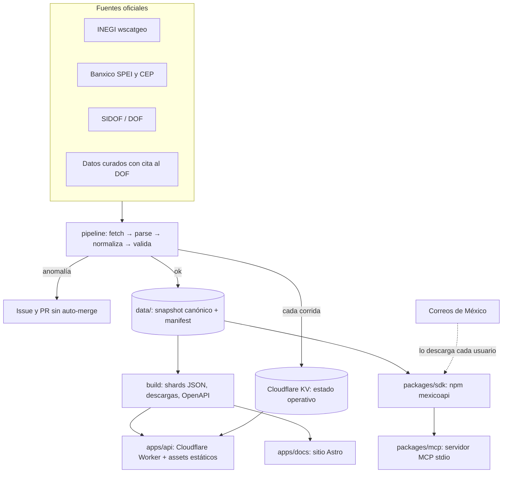

# MéxicoAPI · Diseño técnico v1

Fecha: 2026-10-17 · Estado: propuesta · Autor: Daniel Pereda

Arquitectura de la primera versión de MéxicoAPI: qué datos entran, cómo se obtienen y validan, cómo se publican y con qué garantías. Las decisiones abiertas están en la sección 14.

## 1. Intención

MéxicoAPI publica los datos de referencia de México que todo sistema necesita. Sus cualidades son:

- **Correctos:** cada dato tiene su fuente oficial, su fecha y su hash.
- **Al día:** se actualizan solos, en menos de 24 h después de que la fuente publica.
- **Rápidos:** se sirven como archivos estáticos desde el borde de Cloudflare.
- **Seguros:** solo lectura, sin datos personales, con cadena de suministro verificable.
- **Baratos de mantener:** $0–5 USD al mes y pocas horas por semana.

### Cualidades medibles

| Cualidad | Objetivo v1 | Cómo se mide |
| --- | --- | --- |
| Frescura | Dato automático actualizado ≤ 24 h después de publicarse en la fuente | `meta.as_of` contra la fecha de la fuente; job diario de frescura |
| Exactitud | 0 diferencias contra la fuente en las pruebas de muestreo | Pruebas que comparan registros al azar contra la fuente oficial |
| Procedencia | 100 % de los datasets con fuente, URL, licencia, fecha y sha256 | Validación en CI de cada `manifest.json` |
| Latencia de la API | p95 < 100 ms desde México para endpoints estáticos | Prueba de humo tras cada despliegue más analítica de Cloudflare |
| Disponibilidad | "Mejor esfuerzo", con descarga completa y paquete offline como respaldo | Status page y monitoreo externo gratuito |
| Calidad de código | Núcleo con cobertura ≥ 95 %, pipeline ≥ 85 % | Umbrales de Vitest en CI |
| Costo | ≤ $5 USD al mes | Facturación de Cloudflare |

## 2. Alcance

### v1 (este diseño)

| Dataset | Fuente | Tipo | Licencia | Se redistribuye |
| --- | --- | --- | --- | --- |
| Estados y municipios (CVEGEO) | INEGI wscatgeo v2 (JSON, sin token) | Automático | INEGI: libre, incluso comercial, con crédito | Sí |
| Bancos y participantes SPEI | JSON del portal CEP de Banxico (códigos), cruzado con el PDF oficial de participantes (nombres y participación) | Automático; altas y bajas con revisión humana | Banxico: autorización general con cita | Sí |
| Tipo de cambio FIX y UDIS, desde 2020-01-01 | SIDOF del DOF (JSON sin token): tipos 158 y 159 | Automático diario | Publicación oficial del DOF | Sí |
| Días inhábiles: Ley Federal del Trabajo (cualquier año, por reglas), bancos/CNBV (2025–2026) y SAT (2026) | DOF, LFT art. 74, disposiciones de la CNBV, CFF art. 12 y regla 2.1.6 de la RMF | Curado, con cita al DOF | Textos oficiales | Sí |
| UMA (2017–2026), salario mínimo (2019–2026) y tarifas de ISR (2026) | INEGI, CONASAMI, Anexo 8 de la RMF | Curado, con cita al DOF | INEGI libre; CONASAMI CC-BY; textos oficiales | Sí |
| Validadores: CLABE (con banco y plaza), RFC, CURP y NSS (formato y dígito verificador) | Algoritmos públicos (sección 8.1) | Código propio, sin dependencias | MIT | Sí |
| Códigos postales y colonias (SEPOMEX) | Correos de México | **Lo descarga cada usuario** (sección 7) | "Uso particular… ni su distribución a terceros" | **No** |

### v1.1 y después

- Catálogos CFDI 4.0 (reusando phpcfdi).
- Poder Judicial federal y calendario del IMSS.
- TIIE e INPC.
- Lista 69-B.
- Cuotas del IMSS y subsidio al empleo.
- Paquete PyPI y MCP remoto.

### Fuera de alcance

- Verificación de personas (RENAPO, INE).
- Resolver CAPTCHAs o burlar protecciones anti-bots.
- Consultas en vivo por usuario contra fuentes del gobierno.
- Cualquier dato personal.

## 3. Hallazgos que cambiaron el diseño (verificados el 2026-10-17)

| Hallazgo | Evidencia | Decisión |
| --- | --- | --- |
| El catálogo de SEPOMEX prohíbe distribuirlo a terceros | La primera línea del `CPdescarga.txt` descargado: "se proporciona en forma gratuita para uso particular, no estando permitida su comercialización, total o parcial, ni su distribución a terceros bajo ningún concepto" | No se publica en la API ni en los paquetes. El SDK lo descarga en la máquina del usuario (sección 7). Se pide permiso a SEPOMEX y a la ATDT (sección 14) |
| La versión CC-BY de SEPOMEX en datos.gob.mx son polígonos, no colonias, y bloquea clientes no-navegador | `package_show` de `codigos_postales_entidad_federativa_2026`: 32 shapefiles; la descarga devuelve HTTP 403 "Access Denied" desde curl | Fuera de v1. No se burla el bloqueo |
| La descarga de SEPOMEX funciona con el formulario público | POST con `__VIEWSTATE`, `rblTipo=txt`, `cboEdo=00`: ZIP de 2.1 MB → TXT de 15.7 MB en ISO-8859-1, 159,368 filas, 31,867 CP, 2,478 municipios | El comando del SDK replica ese formulario |
| INEGI responde JSON sin token | `gaia.inegi.org.mx/wscatgeo/v2/mgee/` y `/mgem/25` | Fuente automática de estados y municipios |
| Los códigos de municipio de SEPOMEX coinciden con INEGI | CP 80000: `c_estado=25`, `c_mnpio=006` = INEGI 25006 (Culiacán); 2,478 municipios en ambos | El SDK une CP con CVEGEO |
| SIDOF da tipo de cambio sin token | `sidof.segob.gob.mx/dof/sidof/indicadores/158/13-10-2026/17-10-2026` | Fuente del FIX y de las UDIS sin token de Banxico |
| El portal CEP de Banxico lista instituciones en JSON | `banxico.org.mx/cep/instituciones.do?fecha=…` con códigos de 5 dígitos (40012 BBVA; los 3 finales son el código de banco de la CLABE) | Es la fuente de los códigos y de la membresía activa; el PDF oficial aporta la razón social, el sector y la participación directa. Una diferencia de membresía entre ambos abre un issue |

## 4. Arquitectura



Principios:

1. **El snapshot es la fuente de verdad.** Todo lo publicado (API, descargas, paquetes, docs) se deriva de `data/`, versionado en git. El historial de git es el historial de cambios.
2. **Sin base de datos.** No hay base de datos ni cron en Cloudflare. El Worker corre primero en `/v1` y `/v1/*`, valida cada parámetro, sirve los shards estáticos con `ASSETS.fetch`, calcula funciones puras y pone encabezados. Las descargas (`/descargas/*`) son assets directos y no pasan por el Worker. Lo único que guarda Cloudflare (en KV) es el estado operativo de las corridas, nunca los datos.
3. **Separar lo automático de lo curado.** Los datos automáticos los produce el pipeline. Los curados (días inhábiles, constantes) los escribe una persona en YAML, con cita obligatoria al DOF, y entran por PR revisado.
4. **Falla a lo último bueno.** Si una fuente falla, se sirve el último snapshot válido marcado como desactualizado.
5. **Núcleo puro.** Las reglas (CLABE, días hábiles, validación de formatos) viven en funciones puras sin I/O, probadas con TDD y compartidas por API, SDK y MCP. La aritmética de fechas del núcleo es de enteros (días desde una época, sin `Date`), así que sumar 3650 días hábiles cabe en el límite de CPU de un Worker.

## 5. Estructura del repositorio

Monorepo con pnpm workspaces, TypeScript estricto y ESM.

```
mexicoapi/
├─ packages/
│  ├─ core/        # @mexicoapi/core (interno): esquemas Zod, tipos, funciones puras
│  ├─ pipeline/    # privado: fuentes, parsers, normalizadores, validadores, snapshot, build
│  ├─ sdk/         # npm "mexicoapi": cliente HTTP + datos offline + CLI (sepomex sync)
│  └─ mcp/         # npm "mexicoapi-mcp": servidor MCP stdio de solo lectura
├─ apps/
│  ├─ api/         # Cloudflare Worker (wrangler) + assets estáticos generados
│  └─ docs/        # Astro: docs por dataset, referencia OpenAPI, changelog, status, llms.txt
├─ data/
│  ├─ inegi-estados/    # estados.json, manifest.json, raw/
│  ├─ inegi-municipios/ # municipios.json, manifest.json, raw/
│  ├─ bancos/           # bancos.json, manifest.json, raw/
│  ├─ tipo-cambio-fix/  # fix.json (toda la serie), manifest.json, raw/ (un crudo por año)
│  ├─ udis/             # udis.json (toda la serie), manifest.json, raw/ (un crudo por año)
│  └─ curado/           # dias-inhabiles/*.yaml, constantes/*.yaml (con cita al DOF)
├─ scripts/verify.sh
├─ .github/workflows/  # ci, datos, despliegue, publicación, seguridad, frescura
├─ README.md  LICENSE  DATA_LICENSE.md  SECURITY.md  CONTRIBUTING.md
└─ docs/   # proyecto, investigación, especificaciones
```

`@mexicoapi/core` se empaqueta dentro del SDK y no se publica aparte en v1. Así hay dos paquetes públicos: `mexicoapi` y `mexicoapi-mcp`.

## 6. Modelo de datos

### Manifiesto por dataset (`data/<dataset>/manifest.json`)

```json
{
  "dataset": "inegi.municipios",
  "schema_version": 1,
  "as_of": "2026-10-17",
  "fetched_at": "2026-10-17T06:12:03Z",
  "data_file": "municipios.json",
  "data_sha256": "…",
  "records": 2478,
  "sources": [
    {
      "name": "INEGI, Catálogo Único de Claves de Áreas Geoestadísticas Estatales, Municipales y Localidades",
      "url": "https://gaia.inegi.org.mx/wscatgeo/v2/",
      "license": "Términos de libre uso de la información del INEGI",
      "license_url": "https://www.inegi.org.mx/inegi/terminos.html",
      "citation": "INEGI. Catálogo Único de Claves de Áreas Geoestadísticas…",
      "published_at": null,
      "raw": [
        { "file": "raw/mgem-01.json", "url": "https://gaia.inegi.org.mx/wscatgeo/v2/mgem/01", "sha256": "…" }
      ]
    }
  ]
}
```

El manifiesto describe **los datos** y solo cambia cuando cambian los datos. Así, el historial de git sigue siendo el historial de cambios de los datos.

El estado operativo lo escribe el job `estado-kv` de `datos.yml`, aparte del job que actualiza los datos y solo desde `main`. Mientras no haya registro de corridas (por ejemplo, sin los secretos de Cloudflare), `status` es `unknown`.

El **estado operativo** (última corrida, último éxito, `ok` o `stale`) vive en Cloudflare KV, en una clave por dataset (`estado:<dataset>`). Cada workflow lo escribe al terminar, haya cambios o no y falle o no. `/v1/status` combina ambos: `as_of`, `records`, `data_sha256` y, en las series, `cobertura` (`desde` y `hasta`) del build, y `last_attempt`, `last_success` y `status` (`ok`, `stale` o `unknown`) de KV. `last_success` avanza con `sin_cambios` y con `actualizado` cuando la corrida publicó el cambio (código 0); no avanza con `requiere_revision`, con una corrida que pide revisión (código 3) ni con una fallida.

La frescura no va en `meta` de las respuestas de datos, solo en `/v1/status`. Así los shards son estáticos y su `ETag` no cambia con la hora.

Así una corrida sin cambios no genera commit, PR ni despliegue, y la frescura sigue siendo visible. KV gratis permite 100 mil lecturas y mil escrituras al día; se usan de 1 a 3 escrituras diarias.

**Originales crudos:** el último original de cada fuente se guarda en `data/<dataset>/raw/` (todos los de v1 pesan menos de 1 MB) y su sha256 va en el manifiesto. El historial de git conserva las versiones anteriores, así que cualquiera puede comprobar el hash y reconstruir un dato.

### Registros v1

| Dataset | Campos | Clave |
| --- | --- | --- |
| `inegi.estados` | `cve_ent` (2), `nombre`, `abreviatura`, `cvegeo` | `cve_ent` |
| `inegi.municipios` | `cvegeo` (5), `cve_ent`, `cve_mun` (3), `nombre`, `cve_cabecera` (`null` en las 16 alcaldías de la CDMX, cuya fuente envía "----") | `cvegeo` |
| `bancos` | `codigo` (3, el de la CLABE), `codigo_spei` (4 o 5 dígitos, como lo publica el CEP; BANXICO es `2001`), `nombre_corto` (CEP), `razon_social` (PDF oficial; `null` si no aparece; un inactivo conserva la última conocida, o `null` si nunca apareció en el PDF), `sector` (PDF, con la misma regla), `tipo` (por prefijo del código SPEI: `40` banca múltiple, `37` banca de desarrollo, `90` otras entidades; Banxico aparte), `participacion` (`directa` si está activo y aparece en el PDF; `no_confirmada` si solo aparece en el CEP o si está inactivo, porque ya no participa), `activo`, `baja_detectada` (fecha de muestreo, si dejó de aparecer), `historial` (periodos observados `{codigo_spei, nombre_corto, desde, hasta}` como intervalos `[desde, hasta)`; `hasta: null` es el vigente) | `codigo` |
| `plazas-clabe` | `codigo` (3), `plaza`, `estado` | `codigo` |
| `tipo-cambio.fix` | `fecha_publicacion`, `valor` (texto con 4 decimales) | `fecha_publicacion` |
| `udis` | `fecha`, `valor` (texto con 6 decimales) | `fecha` |
| `dias-inhabiles` | `fecha`, `autoridad` (`lft`, `cnbv`, `sat`), `motivo`, `fuente` (`url` del DOF, `fecha_publicacion`, `fragmento`) | `autoridad + fecha` |
| `constantes.uma` | `anio`, `diaria`, `mensual`, `anual`, `vigencia_desde`, `fuente` | `anio` |
| `constantes.salario-minimo` | `anio`, `zona` (`general`, `zlfn`), `diario`, `vigencia_desde`, `fuente` | `anio + zona` |
| `isr.tarifa` | `anio`, `periodo` (`mensual`, `anual`), tramos: `limite_inferior`, `limite_superior`, `cuota_fija`, `tasa_excedente`; `fuente` | `anio + periodo` |

Reglas de normalización:

- UTF-8 en forma NFC.
- Nombres oficiales tal como los publica la fuente, sin "arreglarlos".
- Claves como strings, con ceros a la izquierda.
- Montos como strings decimales, nunca `float`, para no perder precisión.
- Orden estable por clave, para que los diffs de git sean legibles.

## 7. Códigos postales: el usuario lo descarga

Como SEPOMEX prohíbe la redistribución, MéxicoAPI publica **la herramienta, no los datos**:

1. `npx mexicoapi sepomex sync` descarga el ZIP oficial desde la máquina del usuario, con el formulario público y sin evadir nada.
2. Convierte de ISO-8859-1 a UTF-8.
3. Valida contra el esquema (número de filas, formato de CP, claves de municipio).
4. Une cada CP con el CVEGEO de INEGI.
5. Guarda el resultado en la caché local del usuario (JSON y SQLite).

En código: `import { sepomex } from "mexicoapi/sepomex"` → `await sepomex.sync()` y `sepomex.cp("80000")`.

El MCP local usa esa misma caché. Cada usuario hace su propio "uso particular" de la fuente.

Al ejecutar `sync`, la herramienta muestra el aviso de SEPOMEX y una nota que deja claro que los datos no vienen de MéxicoAPI.

Si SEPOMEX o la ATDT dan permiso o publican el catálogo tabular abierto, se activa un dataset `sepomex.cp` en la API, sin cambiar el contrato del SDK.

## 8. Pipeline

### Etapas

`fetch → parse → normalize → validate → diff → write`

Cada fuente implementa una interfaz común, `Source<TRaw, TRecord>`:

- `fetch()` devuelve bytes y metadatos HTTP. El timeout es de 30 s, con 3 reintentos y backoff exponencial. Usa un User-Agent propio, `mexicoapi-bot/1 (+https://github.com/Dagel4k/mexicoapi)`. Respeta `robots.txt` y hace como máximo 1 petición por segundo por host.
- `parse()` interpreta CSV, JSON, PDF o HTML con parsers probados contra fixtures reales guardados en `packages/pipeline/test/fixtures/`.
- `normalize()` convierte al esquema de `@mexicoapi/core`.
- `validate()` revisa el esquema con Zod y luego los invariantes del dataset. Ejemplos: 32 estados, ≥ 2,400 municipios, códigos de banco únicos.
- `diff()` compara contra el snapshot anterior y calcula altas, bajas y cambios.

FIX y UDIS se guardan como un dataset por serie: toda la historia en un archivo de datos (la serie completa pesa menos de 300 KB) y la respuesta original de la fuente, un archivo por año, en `raw/`. No hay `fuente_dof` por registro: el SIDOF no da la nota del DOF de cada valor, así que la cita va en el manifiesto y quien necesite la nota exacta la busca por fecha en el DOF. Para el Worker, el build parte cada serie en archivos anuales (`v1/_internos/fix/AAAA.json` y `udis/AAAA.json`); cada uno trae el `tramo` que cubre (`desde`, `hasta`) y sus registros, y el meta interno trae la cobertura de la serie. El tramo distingue un día sin publicación de un dato que todavía no se carga.

### Umbrales de anomalía

Si un dataset cambia más que su umbral, el PR se abre **sin auto-merge**, con la etiqueta `revisar` y un issue. Por ejemplo:

- municipios: más de 0.5 % de altas o bajas;
- bancos: más de 3 cambios;
- FIX: valor fuera de ±5 % del día anterior, o una publicación en sábado o domingo (la regla de certeza de la consulta supone que no las hay);
- FIX y UDIS: un alta con fecha anterior a la última ya publicada, porque rellena la serie y la API pudo haber respondido antes otra cosa para ese día.

Es la defensa contra fuentes rotas o manipuladas.

### Datos curados

Son YAML en `data/curado/`. CI exige en cada registro:

- `fuente.url` del DOF (o de la ley vigente en diputados.gob.mx);
- `fuente.fecha_publicacion`;
- `fuente.fragmento`, el texto citado.

Las reglas fijas de la LFT (por ejemplo, el primer lunes de febrero) se calculan con una función del núcleo y se prueban año por año.

### Ejecución

GitHub Actions por dataset con `schedule`:

- INEGI: semanal.
- Bancos: diario.
- FIX y UDIS: diario, a las 13:30 hora de Ciudad de México, después de su publicación.

Si hay cambios, el bot abre un PR `datos(<dataset>): AAAA-MM-DD` con el resumen del diff. Se auto-fusiona si pasa CI y está dentro de los umbrales.

El bot actúa con una **GitHub App propia** (tokens que duran una hora y permisos solo sobre este repo: contenidos, pull requests e issues), no con `GITHUB_TOKEN`. Los PRs abiertos con `GITHUB_TOKEN` no disparan CI ni despliegue, y un token personal de larga duración es justo lo que la sección 12 evita.

Al terminar cada corrida, el job `estado-kv` escribe el estado operativo en KV, y `frescura.yml` abre un issue cuando un dataset se desactualiza ([docs/operacion/cloudflare.md](../operacion/cloudflare.md)).

**Bancos:** las altas y las bajas de instituciones siempre van a revisión humana. Los cambios de nombre se fusionan solos.

Una institución que deja de aparecer no se borra: queda con `activo: false` y su `baja_detectada`, para que las CLABE antiguas se sigan decodificando. Si el JSON del CEP y el PDF oficial no coinciden en membresía, se abre un issue. Los nombres del CEP y del PDF coinciden, así que no hay mapeo curado: si un nombre no cruza, se abre un issue.

## 8.1 Reglas de cálculo (contratos del núcleo)

Estas reglas son la parte con más riesgo legal. Cada una lleva su fundamento en el código, en la respuesta de la API y en la documentación.

### Días hábiles

Tres reglas aplican a todas las autoridades:

- **Cuándo empieza el conteo:** el plazo empieza a contar **el día hábil siguiente** a `desde`, sea `desde` hábil o no. Es el criterio general de cómputo de plazos.
- **Fines de semana:** sábado y domingo son inhábiles en las tres autoridades de v1.
- **El resultado:** siempre es un día hábil.

| Autoridad | Inhábiles | Fundamento |
| --- | --- | --- |
| `lft` | Sábados, domingos y días de descanso obligatorio del art. 74, calculados por regla para cualquier año (incluye el 1 de octubre cada seis años, a partir de 2024) | LFT art. 74 |
| `cnbv` (bancos) | Sábados, domingos y los días del calendario anual que la CNBV publica en el DOF | Disposiciones de la CNBV publicadas en el DOF de cada año |
| `sat` | Sábados, domingos, días del art. 12 del CFF y periodos de vacaciones de la regla 2.1.6 de la RMF | CFF art. 12; RMF regla 2.1.6 |

**SAT y tipo de plazo.** El art. 12 del CFF excluye las vacaciones generales de las autoridades fiscales en los plazos de **declaraciones y pagos**. Por eso, con `autoridad=sat` el endpoint exige `tipo_plazo`:

- `general`: sí cuenta las vacaciones como inhábiles.
- `declaraciones_pagos`: no las cuenta como inhábiles.

**Calendario incompleto.** Si el cálculo cruza un año cuyo calendario no está completo, la API responde **422** problem+json de tipo `calendario-incompleto`, y nombra el año y la autoridad que faltan. Hoy ese es el caso del SAT 2027, y del 2026 mientras falte su segundo periodo de vacaciones.

Solo con `permitir_incompleto=true` calcula con lo conocido, y entonces responde con `advertencias[]`. Un plazo legal equivocado sin aviso es peor que un error.

### Tipo de cambio FIX

Hay dos modos, y la operación cita su regla:

| Modo | Llamada | Qué responde |
| --- | --- | --- |
| Publicación | `GET /v1/tipo-cambio/fix?publicado=AAAA-MM-DD` | El valor publicado en el DOF ese día, o 404 si ese día no hubo publicación |
| Operación (lo que pide el SAT) | `GET /v1/tipo-cambio/fix?operacion=AAAA-MM-DD` | El último FIX publicado en el DOF **antes** de esa fecha, la fecha de esa publicación y la cita del CFF art. 20 |
| Último | `GET /v1/tipo-cambio/fix/ultimo` | La publicación más reciente cargada |

No se necesita el calendario bancario: basta la última publicación anterior. Las UDIS tienen un solo modo, `GET /v1/udis?fecha=AAAA-MM-DD`, con un valor por cada día del calendario.

Las reglas de consulta viven en el núcleo, para que el SDK y el MCP den la misma respuesta que la API.

**Certeza de la operación.** `operacion` solo responde cuando la respuesta es cierta. Si falta cargar la publicación de la víspera, el Worker no devuelve un valor anterior: responde `dato-no-disponible`. Los fines de semana no cuentan, porque no se espera publicación. El costo es que un cliente que pregunta temprano por mañana recibe 404 hasta la siguiente corrida.

**Dos 404.** `no-encontrado` es definitivo: ese día no hubo publicación o la fecha es anterior al inicio de la serie. Con `publicado`, un sábado o domingo posterior al último dato también es `no-encontrado` si de por medio solo hay fin de semana: el DOF no publica el FIX esos días. `dato-no-disponible` puede cambiar: la fecha es posterior a lo cargado y falta algún día entre semana, o falta la víspera. Ambos traen `fecha` y `cobertura`; un cliente que solo mira el estado HTTP no los distingue, el `type` sí.

### Validadores

Se escriben en el núcleo, sin dependencias. Cada uno se prueba contra vectores de prueba tomados de librerías existentes, a las que se da crédito (`clabe-validator` MIT, `python-stdnum` LGPL: solo como referencia de vectores, sin copiar código).

Cada validador responde por separado:

- `formato_valido`;
- `digito_verificador_valido`, cuando aplica;
- la nota fija "no confirma que exista ante el SAT, RENAPO o el IMSS".

| Validador | Qué revisa |
| --- | --- |
| CLABE | 18 dígitos, dígito de control (pesos 3, 7, 1, módulo 10), banco (dataset `bancos`) y plaza (dataset `plazas-clabe`) |
| RFC | Estructura de persona física (13) y moral (12), fecha válida y dígito verificador de la homoclave |
| CURP | Estructura, fecha, sexo, entidad y dígito verificador (algoritmo reconstruido y documentado públicamente) |
| NSS | 11 dígitos y dígito verificador (Luhn) |

El catálogo de plazas de la CLABE no tiene fuente oficial pública. Entra como dataset curado de **referencia**, con crédito a `clabe-validator`, y lo marca `meta.referencial: true`.

## 9. API pública (Cloudflare Worker)

### Diseño

- **Base:** `https://<dominio>/v1/`. Sin dominio propio, se usa `mexicoapi.<cuenta>.workers.dev`.
- **Protocolo:** REST de solo lectura, JSON en UTF-8, versión en la ruta (`/v1`). Los cambios incompatibles van a `/v2`.
- **Respuesta:** `{ "data": …, "meta": { dataset, as_of, sources: [{ name, url, license, license_url, citation }], docs } }`. `sources` es una lista porque un dataset puede tener varias fuentes (bancos tiene dos). `meta` no lleva el estado de frescura: eso vive en `/v1/status`, que responde `{ "data": [...] }` sin `meta`. `/` y `/v1` responden un índice.
- **Errores:** `application/problem+json` (RFC 9457), con `type`, `title`, `status`, `detail` e `instance`. Nunca incluyen trazas. El `type` es la URI absoluta de la sección correspondiente de `docs/api/problemas.md` en GitHub (`https://github.com/Dagel4k/mexicoapi/blob/main/docs/api/problemas.md#<tipo>`), estable sin dominio propio; si llega un dominio, los `type` se quedan como identificadores.
- **Caché:**
  - Datos que cambian: `Cache-Control: public, max-age=3600, stale-while-revalidate=86400, stale-if-error=604800`. No lleva `s-maxage=86400`: un caché compartido de 24 h rompería la meta de frescura de 24 h.
  - `/v1/tipo-cambio/fix/ultimo`: `public, max-age=300`, sin `stale-while-revalidate` ni `stale-if-error`, porque cambia con cada publicación.
  - `/v1/status`: `public, max-age=60`. Errores: `no-store`.
  - Históricos (cuando existan): `public, max-age=31536000, immutable`.
  - `ETag` = hash del contenido en los shards; con `If-None-Match` responde 304.
- **Encabezados:** `Access-Control-Allow-Origin: *` (expone `ETag` y `Retry-After`), `X-Content-Type-Options: nosniff`, `Content-Security-Policy: default-src 'none'; frame-ancestors 'none'`. Sin cookies. Solo `GET`, `HEAD` y `OPTIONS`.
- **Privacidad:** el Worker no registra ni guarda consultas (la observabilidad está desactivada). Una CLABE viaja en la ruta; quien no quiera enviarla puede validarla sin red con el SDK.

### Endpoints v1

| Método y ruta | Qué devuelve | Cómo se sirve |
| --- | --- | --- |
| `GET /v1/estados` | 32 estados | Estático |
| `GET /v1/estados/{cve_ent}` | Un estado | Estático |
| `GET /v1/estados/{cve_ent}/municipios` | Municipios del estado | Estático |
| `GET /v1/municipios` · `GET /v1/municipios/{cvegeo}` | Todos los municipios (unos 300 KB, también en las descargas) o uno | Estático |
| `GET /v1/bancos` · `GET /v1/bancos/{codigo}` | Bancos y participantes SPEI | Estático |
| `GET /v1/clabe/{clabe}` | `valido`, `formato_valido`, `digito_verificador_valido`, `errores[]` y `detalle` (`banco`, `plaza`, `cuenta`, `digito_control`). La CLABE de un banco inactivo tiene formato válido y lleva `banco.activo: false` | Worker (función pura) |
| `GET /v1/tipo-cambio/fix?publicado=AAAA-MM-DD` · `?operacion=AAAA-MM-DD` · `/v1/tipo-cambio/fix/ultimo` | FIX por fecha de publicación o para una operación (sección 8.1) | Worker sobre archivos anuales estáticos |
| `GET /v1/udis?fecha=AAAA-MM-DD` | Valor de la UDI | Worker sobre archivos anuales estáticos |
| `GET /v1/dias-inhabiles?autoridad=lft&anio=2026` | Lista con citas | Worker (función pura) |
| `GET /v1/dias-habiles?autoridad=lft&desde=AAAA-MM-DD&dias=15` | Fecha resultante, días inhábiles saltados con su cita, `advertencias[]`; 422 si el calendario está incompleto (sección 8.1) | Worker (función pura) |
| `GET /v1/plazas-clabe` | Catálogo de referencia de plazas | Estático |
| `GET /v1/constantes/uma/{anio}` · `/v1/constantes/salario-minimo/{anio}` · `/v1/isr/tarifa/{periodo}/{anio}` | Valores con fuente | Estático |
| `GET /v1/status` | Frescura y estado de cada dataset (build más KV) | Worker: lee KV con caché de 60 s |
| `GET /v1/openapi.json` | Especificación OpenAPI 3.1 | Estático |
| `GET /descargas/*` | JSON, CSV y `mexicoapi.sqlite` completos | Estático |

Hoy están implementadas las rutas de estados, municipios, bancos, `clabe`, `dias-habiles` y `dias-inhabiles` (solo `lft`), `status` y `openapi.json`. `autoridad` acepta solo `lft` hasta que existan los calendarios curados de CNBV y SAT; agregar valores al enum es compatible. Las demás filas de la tabla llegan con sus datasets, y entonces `dias-habiles` agrega `tipo_plazo` para el SAT (sección 8.1).

`dias-habiles` acepta `dias` de 1 a 3650. Con `permitir_incompleto=true` calcula fuera de la cobertura del calendario (2007-01-01 a 2100-12-31) con `advertencias`; si no, responde 422 `calendario-incompleto`.

### Validación de entradas

Cada parámetro se valida con una expresión regular estricta antes de tocar cualquier dato. Por ejemplo, `cvegeo` es `^\d{5}$` y `clabe` es `^\d{18}$`. Una entrada inválida devuelve un 400 problem+json.

Un parámetro de query desconocido, repetido o vacío, o un segmento vacío (`?&`), también da 400. Un cliente que agrega `?_=` para romper el caché recibe 400. Una ruta con `%` da 404, y una ruta con `/` final redirige con 308 a la ruta sin él.

### Despliegue

Dos Workers en la misma cuenta: `mexicoapi-staging` y `mexicoapi` (producción), ambos en `workers.dev`. Staging es un Worker aparte y no una URL de vista previa, porque las vistas previas con assets y rate limiting no están garantizadas.

`apps/api/scripts/cloudflare.ts configurar` resuelve (o crea) el namespace de KV titulado `mexicoapi-estado` y genera la configuración de cada entorno a partir de `wrangler.jsonc`, con el binding `ESTADO` de KV y el de rate limiting. La base se llama `mexicoapi-local`: un `wrangler deploy` a mano con ella no publica producción sin esos bindings. El namespace se comparte entre staging y producción, porque el estado es del pipeline de datos y no del entorno.

`despliegue.yml` corre en cada merge a `main` y a mano, solo desde `main` y en el Environment `produccion`: despliega a staging, corre la prueba de humo (`apps/api/scripts/humo.ts`, hasta 5 intentos con esperas de 10, 20, 30 y 60 s), despliega a producción y vuelve a correr el humo si la versión llegó a subirse, aunque el paso de despliegue fallara después. Si el humo de producción falla, ejecuta `wrangler rollback --yes` y la corrida queda en rojo; en el primer despliegue no hay versión anterior y el resumen dice que no se pudo revertir. El resumen lista las URLs, los IDs de versión y el resultado de la reversión. Sin los secretos de Cloudflare no despliega y deja un aviso.

Rate limiting: el binding de Workers limita a 600 peticiones por minuto por IP (las IPv6 por /64) y por ubicación de Cloudflare, en todo lo que pasa por el Worker. Un cliente muy intenso recibe 429 y debe usar las descargas. Los pasos de la cuenta, el token, el rollback y los límites están en [docs/operacion/cloudflare.md](../operacion/cloudflare.md).

### Límites de la plataforma

Assets estáticos ≤ 20,000 archivos en el plan gratis: los archivos por fecha se agrupan por año. Cada archivo pesa ≤ 25 MiB.

El Worker corre primero en `/v1` y `/v1/*` y sirve los shards con `ASSETS.fetch`, así que cada consulta de la API cuenta contra el límite del Worker: 100,000 peticiones al día en el plan gratis y 10 millones al mes en el plan de 5 USD. Las descargas son assets directos y no cuentan. Se eligió así porque los assets sin extensión no permiten `/v1/estados/25` y `/v1/estados/25/municipios` a la vez (serían un archivo y una carpeta con el mismo nombre), y porque así cada parámetro se valida antes de tocar un archivo.

## 10. SDK (`mexicoapi` en npm)

- **Sin dependencias en tiempo de ejecución.** ESM, tree-shakeable y con tipos incluidos.
- **Entradas:**
  - `mexicoapi`: cliente HTTP más validadores.
  - `mexicoapi/datos`: datos offline de los datasets estables (estados, municipios, bancos, constantes, días inhábiles) incluidos en el paquete.
  - `mexicoapi/sepomex`: descarga local (sección 7).
  - `mexicoapi/cli`: binario `mexicoapi`.
- **Cliente:**
  - `fetch` nativo, timeout configurable y reintentos solo en métodos idempotentes;
  - errores tipados (`MexicoApiError` con el problem+json);
  - caché opcional en memoria.
- **Versionado:** semver para la API del SDK. Los datos incluidos se actualizan con versiones *patch* semanales automáticas (changesets) cuando hay cambios.
- **Tamaño:** núcleo y cliente ≤ 15 KB gzip. Los datos van en entradas separadas para no inflar a quien no los usa.
- **Datos que caducan** (FIX, UDIS, días inhábiles, constantes): por defecto se consultan en la API. Si no hay red, se usan los datos del paquete y la respuesta lo dice con `origen: "paquete"`, su `as_of` y una advertencia si tienen más de 7 días.
  - Los datos estables (estados, municipios, bancos, plazas) se leen del paquete sin red.
  - `{ offline: true }` fuerza el modo sin red.
- **Entornos:** el cliente, los validadores y `mexicoapi/datos` funcionan en Node ≥ 20, navegadores, Cloudflare Workers, Deno y Bun.
  - `mexicoapi/sepomex` y la CLI requieren Node ≥ 22.13: la caché se guarda en JSON y, si `node:sqlite` está disponible, también en SQLite.
  - Las pruebas cubren Node 20, 22 y 24, más un Worker real en workerd con `unstable_startWorker` (sección 13).

## 11. Servidor MCP (`mexicoapi-mcp`)

- **Transporte:** stdio (`npx -y mexicoapi-mcp`). Usa el SDK, ya sea con datos offline o con la API.
- **Herramientas:** todas con `readOnlyHint: true`.
  - Las de datos que caducan (FIX, UDIS, días inhábiles, constantes) consultan la API por defecto (`openWorldHint: true`). Sin red, responden con los datos del paquete y una advertencia de antigüedad.
  - Las de datos estables y validación funcionan sin red (`openWorldHint: false`).
  - Lista de herramientas:
    - `buscar_municipio`
    - `validar_clabe`
    - `banco_por_codigo`
    - `tipo_de_cambio_fix`
    - `udis`
    - `dias_inhabiles`
    - `sumar_dias_habiles`
    - `constantes`
    - `codigo_postal` (solo si el usuario ya hizo `sepomex sync`)
- **Respuestas:** siempre incluyen `as_of` y la fuente con URL, para que el agente pueda citar.
- **Seguridad:** las descripciones de las herramientas son constantes del código, versionadas y probadas. No hay herramientas que escriban ni que hagan peticiones arbitrarias.
- **v1.1:** MCP remoto sin estado en Cloudflare (`createMcpHandler`), registro oficial de MCP y directorios de conectores de los asistentes.

## 12. Seguridad

| Amenaza | Mitigación |
| --- | --- |
| Paquete malicioso en dependencias | Lockfile, `minimumReleaseAge` de pnpm (no instalar versiones con menos de 7 días), Dependabot con cooldown de 7 días y revisión, `osv-scanner` en CI, mínimo de dependencias |
| Robo de credenciales de publicación | npm trusted publishing con OIDC y procedencia, 2FA obligatorio, sin tokens largos en el repo |
| Fuente comprometida o datos envenenados | Solo HTTPS, sha256 del original guardado, umbrales de anomalía, revisión humana de datos curados |
| Secretos filtrados | gitleaks en pre-commit y en CI. Secretos de Actions, todos con permiso mínimo: token de Cloudflare (despliegue y KV, en el Environment `produccion`, solo para `main`), credenciales de la GitHub App del bot y, en v1.1, token de Banxico SIE. Ninguno en el código |
| Abuso o saturación de la API | Rutas estáticas sin cómputo; rate limiting del Worker en lo que pasa por él (`/v1`, 600/min por IP y por ubicación; las descargas en `/descargas/*` son assets directos y no cuentan); descargas completas documentadas |
| Inyección vía parámetros | Expresiones regulares estrictas; nunca se construyen rutas de archivo con entrada sin validar |
| Prompt injection vía MCP | Herramientas de solo lectura, descripciones fijas, sin texto libre de terceros en las descripciones |
| Workflows de GitHub inseguros | Acciones fijadas por SHA, `permissions` mínimos por job, nada de `pull_request_target` con código ajeno |
| Repositorio | Protección de `main`, PR obligatorio, checks requeridos, CodeQL, OpenSSF Scorecard, `SECURITY.md` con canal privado de reporte |

## 13. Calidad, pruebas y entrega

- **TDD para el núcleo y los parsers.** Primero la prueba roja con caso real, luego el código.
  - CLABE: pruebas de propiedades con fast-check (dígito de control).
  - Días hábiles: tabla de casos por autoridad y año.
  - Parsers: fixtures reales anonimizados donde aplique.
- **Pruebas del Worker.** Dos capas:
  - unidad, en Node, con un `ASSETS` falso;
  - integración y contrato, en workerd real con `unstable_startWorker`: arrancan el Worker construido y comparan cada respuesta contra el OpenAPI.

  No se usa `@cloudflare/vitest-pool-workers`, que exige Vitest 4. Si wrangler cambia esa API inestable, se ajusta la prueba. Además hay una prueba de humo contra el despliegue de staging antes de producción (sección 9).
- **`scripts/verify.sh`** (definición de terminado) corre:
  1. Biome (formato y lint);
  2. `tsc --noEmit`;
  3. Vitest con umbrales de cobertura, y las pruebas en varias zonas horarias;
  4. build de paquetes y API (shards, descargas y OpenAPI);
  5. integración y contrato de la API en workerd;
  6. validación de todos los `data/*/manifest.json` y snapshots;
  7. gitleaks.

  El build del sitio de docs se suma cuando exista el sitio.
- **Workflows:**
  - `ci.yml` (cada PR);
  - `datos.yml` (cron; un workflow con un grupo por dataset);
  - `despliegue.yml` (staging en cada merge a `main`, producción tras la prueba de humo, rollback si el humo de producción falla);
  - `frescura.yml` (diario, 13:00 de la Ciudad de México: consulta `/v1/status` con la variable `API_URL` y abre un issue por cada dataset desactualizado, o uno de "API sin respuesta"; un estado `unknown` no cuenta);
  - `publicacion.yml` (changesets: npm con procedencia), pendiente;
  - `seguridad.yml` (CodeQL, osv-scanner, Scorecard), pendiente.
- **Ramas:** una por tarea, PR a `main` con CI verde. `main` siempre desplegable.
- **Herramientas:** Node 24 LTS, pnpm (versión fijada en `packageManager`), TypeScript estricto, Biome, Vitest, Zod, Wrangler, Astro, `@modelcontextprotocol/sdk`. Las versiones exactas se fijan al crear el proyecto, consultando la documentación vigente.

## 14. Decisiones y pendientes

Tomadas:

| Decisión | Resultado |
| --- | --- |
| Repositorio | Público desde el inicio, en la cuenta personal `Dagel4k` |
| Validación previa con usuarios | Se avanza sin entrevistas; el orden de los datos se revisa al lanzar |
| Estado operativo | Cloudflare KV, separado del manifiesto (sección 6) |
| Originales crudos | Guardados en git junto al snapshot (sección 6) |
| Bot de datos | GitHub App con permisos mínimos (sección 8) |
| Bancos | Altas y bajas a revisión humana; bajas marcadas como inactivas (sección 8) |
| Días hábiles | Conteo desde el día hábil siguiente, `tipo_plazo` para el SAT y 422 con calendario incompleto (sección 8.1) |
| FIX | Dos modos: por publicación y por operación (sección 8.1) |
| SDK | Datos que caducan desde la API con respaldo en el paquete; Node ≥ 20 y runtimes web (sección 10) |

Decisiones de la API (secciones 9 y 13), con lo que pasa si resultan equivocadas:

| Decisión | Resultado | Si está mal |
| --- | --- | --- |
| Worker primero en `/v1` | El Worker corre primero en `/v1` y `/v1/*` y sirve los shards con `ASSETS.fetch`; las descargas son assets directos. Cada parámetro se valida antes de tocar un archivo | Cada consulta cuenta en el límite del Worker (100 mil al día gratis; 10 millones al mes con el plan de 5 USD) |
| `meta.sources` | `meta` lleva `sources` (lista), no `source`, porque bancos tiene dos fuentes | Cambio de contrato antes de publicar: barato |
| Sin `status` en `meta` | La frescura vive en `/v1/status`; los shards son estáticos y el `ETag` no cambia con la hora | Agregar `status` después es compatible |
| Caché sin `s-maxage` | `max-age=3600, stale-while-revalidate=86400, stale-if-error=604800`: un caché compartido de 24 h rompería la meta de frescura | Más revalidaciones; con `ETag` son 304 baratos |
| `type` de los errores | Apuntan a `docs/api/problemas.md` en GitHub, una URI absoluta y estable sin dominio propio | Si llega un dominio, los `type` se quedan como identificadores |
| Parámetros estrictos | Un parámetro desconocido o repetido da 400 | Un cliente que agrega `?_=` para romper el caché recibe 400 |
| Autoridad `lft` | `dias-habiles` y `dias-inhabiles` aceptan solo `lft` hasta que existan los calendarios curados de CNBV y SAT | Agregar valores al enum es compatible |
| Bancos inactivos en `clabe` | La CLABE de un banco inactivo tiene formato válido y la respuesta lo marca con `activo: false` | El cliente decide; no se le oculta el banco |
| CSV | RFC 4180: UTF-8 sin BOM y `\r\n`. El build falla ante campos que empiezan con `=`, `+`, `-` o `@` en vez de alterarlos | Excel en Windows puede mostrar mal los acentos con doble clic; se documenta importar como UTF-8 |
| Pruebas del Worker | Unidad en Node con `ASSETS` falso y contrato en workerd real con `unstable_startWorker`, dentro de `verify.sh` | Si wrangler cambia esa API inestable, se ajusta la prueba |
| `/v1/municipios` | Se agrega la lista completa, que el diseño original no tenía | Ruta extra de 300 KB; también está en las descargas |

Pendientes:

| Pendiente | Cuándo se necesita |
| --- | --- |
| Pedir a SEPOMEX y a la ATDT el catálogo tabular con licencia abierta | Cuanto antes; no bloquea la v1 |
| Cuenta de Cloudflare, token con permisos mínimos, secretos `CLOUDFLARE_API_TOKEN` y `CLOUDFLARE_ACCOUNT_ID` y variable `API_URL`: los crea el dueño de la cuenta, con los pasos de [docs/operacion/cloudflare.md](../operacion/cloudflare.md) | Al desplegar la API (paso 4) |
| GitHub App del bot de datos | Al automatizar los datos (paso 3) |
| Registrar `mexicoapi` y `mexicoapi-mcp` en npm con 2FA | Antes de la primera publicación (paso 5) |
| Dominio | Antes del lanzamiento; mientras tanto, `workers.dev` |

## 15. Orden de construcción (resumen para el plan)

1. **Base:** monorepo, herramientas, `verify.sh`, CI, protección de rama.
2. **Núcleo (TDD):** CLABE, formatos RFC/CURP/NSS, motor de días hábiles.
3. **Pipeline y primeros datasets:** INEGI y bancos, con manifiestos y umbrales.
4. **Build y API:** shards, OpenAPI, Worker, despliegue a staging, pruebas de contrato.
5. **SDK:** cliente, datos offline, `sepomex sync`.
6. **MCP stdio.**
7. **Tipo de cambio y UDIS** desde SIDOF, con histórico.
8. **Datos curados:** días inhábiles (LFT, CNBV, SAT 2025–2026), UMA, salario mínimo, ISR 2026, todo verificado en el DOF.
9. **Sitio de documentación:** Astro, OpenAPI, status, llms.txt.
10. **Endurecimiento:** workflows de seguridad, procedencia de npm, Scorecard, revisión de seguridad.
11. **Lanzamiento** (fase 3 del proyecto).
